我最近开始频繁通过 `ssh username@192.168.x.x` 登录远程服务器搞开发，手动输入长密码又慢又累又容易出错。通过**非对称密钥认证（Public Key Authentication）**与 **SSH Client Config 配置文件**，可以将原本繁琐的连接命令缩减为单单词别名（例如 `ssh myserver`），同时大幅提升连接安全性。

本文记录这一套配置小连招，涵盖密钥对生成、公钥部署、客户端别名配置、权限规范以及远程初始密码修改与安全加固。

---

## 核心流程全览

配置 SSH 便捷登录的核心逻辑分为公钥认证与别名映射两部分：




---

## 第一步：在本地生成 SSH 密钥对

如果本地还没有 SSH 密钥，推荐使用现代、高效且高安全性的 `ed25519` 算法（性能与安全性均优于传统的 RSA 2048/4096）：

```bash
ssh-keygen -t ed25519 -C "developer@workstation"
```

终端会给出交互提示：
1. **保存路径**：默认保存在 `~/.ssh/id_ed25519`，直接按回车确认。
2. **密码短语 (passphrase)**：可直接连按两次回车留空（追求极致便捷免密）；也可以设置独立 passphrase 并配合系统 Keyring/SSH Agent 托管。

生成完成后，`~/.ssh/` 目录下会新增两个文件：
- `id_ed25519`：**私钥**，绝对不能泄露给任何人或上传到公共平台。
- `id_ed25519.pub`：**公钥**，用于分发至需要登录的远程服务器。

---

## 第二步：分发公钥至远程主机

### 方式一：使用 `ssh-copy-id` 自动写入（推荐）

macOS 与绝大部分 Linux 发行版均自带 `ssh-copy-id` 命令。运行以下指令：

```bash
# 请将 <remote_user> 替换为远程服务器实际用户名，<remote_ip> 替换为目标主机 IP
ssh-copy-id <remote_user>@<remote_ip>
```

> **示例**：
> ```bash
> ssh-copy-id user@192.168.1.100
> ```

终端会提示输入一次远程用户的当前密码。验证通过后，公钥内容会自动追加到远程主机的 `~/.ssh/authorized_keys` 中，并自动设置正确的目录权限。

### 方式二：手动配置（当无法使用 `ssh-copy-id` 时）

如果网络受限或环境缺少 `ssh-copy-id`，可以通过 SSH 管道一键注入：

```bash
cat ~/.ssh/id_ed25519.pub | ssh <remote_user>@<remote_ip> "mkdir -p ~/.ssh && chmod 700 ~/.ssh && cat >> ~/.ssh/authorized_keys && chmod 600 ~/.ssh/authorized_keys"
```

---

## 第三步：配置本地 SSH 别名

完成公钥上传后虽然可以免密，但每次仍需记忆长 IP 和用户名。通过本地客户端配置文件 `~/.ssh/config`，可以为远程主机创建易记的短别名。

1. 打开或创建本地配置文件：
   ```bash
   vim ~/.ssh/config
   # 或者使用 nano ~/.ssh/config
   ```

2. 追加以下主机配置块：
   ```text
   # 远程服务器别名，可随意命名（如 dev, lab, server-a）
   Host myserver
       HostName 192.168.1.100
       User remote_user
       Port 22
       IdentityFile ~/.ssh/id_ed25519
       ServerAliveInterval 60
       ServerAliveCountMax 3
   ```

   **关键参数说明：**
   - `Host`：在终端调用的主机别名。
   - `HostName`：远程主机的真实 IP 地址或域名。
   - `User`：登录的远程用户名。
   - `Port`：SSH 服务端口（默认为 22，非标准端口在此指定）。
   - `IdentityFile`：显式指定使用的私钥路径。
   - `ServerAliveInterval` / `ServerAliveCountMax`：长连接保活设置，避免空闲一段时间后 SSH 会话卡死或中断。

---

## 第四步：核验关键文件权限

SSH 对文件权限有极严苛的安全检查机制。若本地或远程权限过于宽松，SSH 客户端或服务进程会出于安全考量直接拒绝使用密钥认证并降级回密码模式。

### 本地权限检查：
```bash
chmod 700 ~/.ssh
chmod 600 ~/.ssh/id_ed25519
chmod 644 ~/.ssh/id_ed25519.pub
chmod 600 ~/.ssh/config
```

### 远程端权限检查（登录后确认）：
```bash
chmod 700 ~/.ssh
chmod 600 ~/.ssh/authorized_keys
```

---

## 第五步：验证登录与远程密码更新

### 1. 测试快捷登录
现在可以在本地终端直接通过别名发起连接：

```bash
ssh myserver
```

此时应直接进入远程 Shell，全程无需输入任何密码或 IP 地址。

### 2. 更改默认/初始密码
如果使用的是系统初始化分配的默认密码，登录后建议第一时间更新：

```bash
passwd
```

按照提示依次输入旧密码与两次新密码：
```text
Changing password for <remote_user>.
Current password:    # 输入旧密码（输入时不显示字符）
New password:        # 输入新密码
Retype new password: # 再次输入确认
```

---

## 第六步：进阶安全与工作流集成

### 1. 禁用密码认证（可选加固）
在验证密钥登录稳定可用后，可以在远程服务器上关闭密码登录，彻底杜绝暴力破解风险。

编辑远程 `/etc/ssh/sshd_config`：
```bash
sudo vim /etc/ssh/sshd_config
```
修改或取消注释以下配置项：
```text
PasswordAuthentication no
ChallengeResponseAuthentication no
```
保存后重启 SSH 服务：
```bash
# Ubuntu / Debian
sudo systemctl restart ssh

# CentOS / RHEL
sudo systemctl restart sshd
```

### 2. VS Code Remote-SSH 无缝协同
配置了 `~/.ssh/config` 后，VS Code 的 `Remote - SSH` 插件会自动解析该文件。打开命令面板（`Cmd + Shift + P`），输入 `Remote-SSH: Connect to Host...`，即可直接在列表中点击 `myserver` 开启远程开发容器与工作区，无需任何额外配置。
