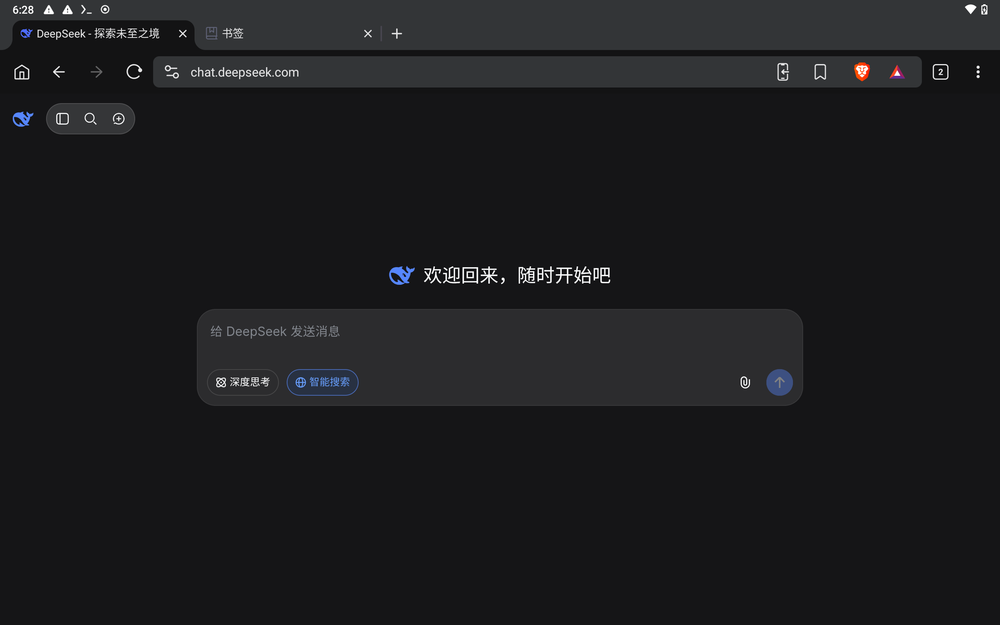
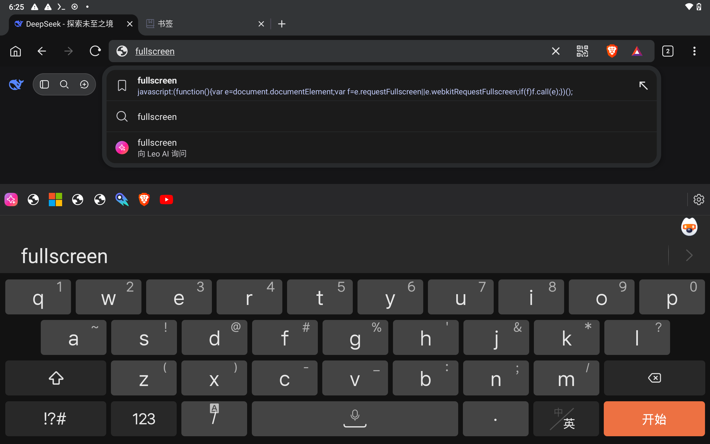
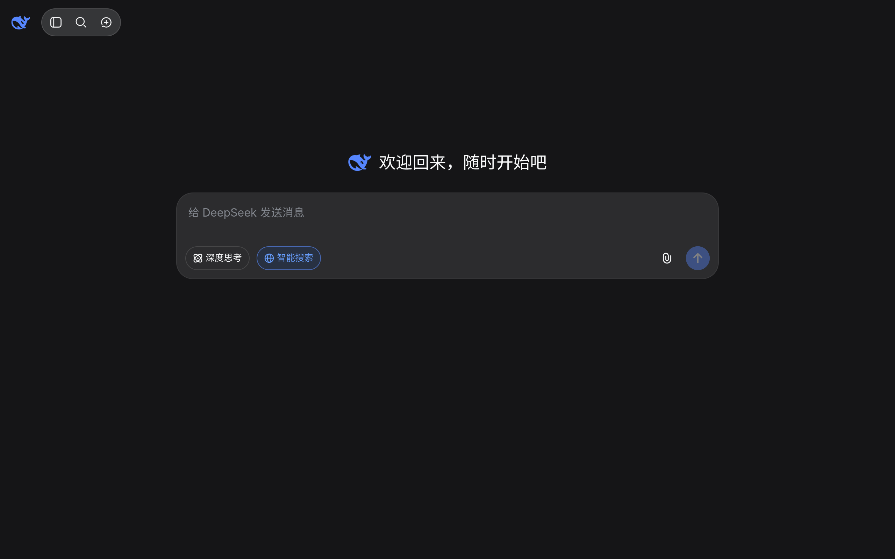

在安卓平板上打开 [DeepSeek 网页版](https://chat.deepseek.com/)，顶部的系统状态栏、标签栏和地址栏会占去一部分空间。给 Brave 添加一个名为 `fullscreen` 的书签，就能在需要时让当前网页进入全屏。配置和使用都在平板上的 Brave 中完成，无需安装扩展或连接电脑。

## 实测环境和效果

本文于 2026 年 10 月 29 日在以下环境验证：

| 项目 | 实测环境 |
| --- | --- |
| 平板 | 十多年前的 32 位老 Tab |
| 系统 | Android 10 |
| 浏览器 | Brave 1.98.62 |
| 页面 | `https://chat.deepseek.com/` |

当前很多浏览器都不提供 32 位的版本，在有限的几个能安装的浏览器间比较了一下，感觉 Brave 比较全面就用它了。


_进入全屏前，DeepSeek 页面上方有三层界面占用空间。_

## 创建 fullscreen 书签

### 先收藏一个普通网页

1. 在 Brave 中打开 `https://chat.deepseek.com/`，按需要完成登录。
2. 点击地址栏右侧的书签图标，将当前页面保存为书签。
3. 打开右上角的 **⋮ → 书签 → 移动设备书签**，找到刚保存的书签。如果保存在其他文件夹，就到对应文件夹查找。

### 修改名称和网址

点击这条书签右侧的 **⋮ → 修改**，设置两个字段：

- **名称**：`fullscreen`，全部小写。
- **网址**：删除原来的网页地址，替换为下面完整的一行代码。

```javascript
javascript:(function(){var e=document.documentElement;var f=e.requestFullscreen||e.webkitRequestFullscreen;if(f)f.call(e);})();
```

检查网址确实以 `javascript:` 开头，然后点击左上角的返回箭头，保存修改。

**书签名称可以写成小写，代码里的大小写要保留。** 特别是 `requestFullscreen` 和 `webkitRequestFullscreen`，不能一起改成全小写。

普通书签保存的是一个网页地址；这条书签保存的是一小段在当前网页执行的 JavaScript，通常称为“书签脚本”（bookmarklet）。它会向浏览器请求让整个网页进入全屏。

## 在 DeepSeek 页面调用书签

1. 返回已经打开的 DeepSeek 页面。
2. 点击 Brave 的地址栏，输入 `fullscreen`。
3. 在下拉建议中，点击名为 **fullscreen** 的书签。

要选的是**带书签图标、第二行以 `javascript:` 开头**的那一项。输入后直接点击这一行即可；带放大镜的同名项是搜索建议。


_选择第一项书签，下面的搜索建议和 Leo AI 建议都不是这次要用的入口。_

点击后，DeepSeek 页面进入全屏。实测中，Brave 的地址栏、标签栏和 Android 系统状态栏都已隐藏，DeepSeek 自己的导航和输入框继续显示。


_全屏后的 DeepSeek 网页。截图来自同一个平板，展示的是未输入消息的首页。_

书签只需创建一次。以后打开 DeepSeek，按“**地址栏输入 fullscreen → 点击同名书签**”这两步操作即可。

## 退出全屏和再次进入

按平板的**返回键**即可退出全屏，重新显示浏览器的地址栏和标签栏，再调用书签也能重新进入全屏。

Brave 进入全屏时可能提示“从顶部拖动，然后轻触返回按钮”，按屏幕提示操作即可。如果屏幕键盘正打开，返回键可能先收起键盘，再按一次退出全屏。

刷新、加载新页面或切换应用后，全屏可能退出。需要时，在目标网页上重新调用 `fullscreen` 书签。这个方法适合按需切换全屏，不会把所有后续页面永久固定在全屏状态。

## 点击书签没有反应时

先检查当前网站是否允许执行脚本：

1. 在 DeepSeek 页面点击地址栏右侧的 **Brave 狮子图标**。
2. 展开 **高级控制**。
3. 查看 **拦截脚本**。如果处于开启状态，将这一项关闭，再按需要重新加载页面。
4. 返回 DeepSeek，再从地址栏调用书签。

这条书签本身需要执行 JavaScript。“拦截脚本”开启时，书签代码也可能无法执行，因此没有反应时应先检查这一项。

只需检查当前站点的脚本开关。Brave 支持分别保存各个网站的盾牌设置，具体可参看[官方的站点设置说明](https://support.brave.app/hc/en-us/articles/360023646212-How-do-I-configure-global-and-site-specific-Shields-settings)。

如果脚本已经允许，那么再核对：

- **保存位置**：代码应保存在书签的“网址”字段，名称仍是 `fullscreen`。
- **代码内容**：保留开头的 `javascript:`，整行复制，函数名的大小写与上文一致。
- **调用位置**：先回到 DeepSeek 页面，再输入书签名，选择带书签图标的那条建议。

## 适用范围

代码中的 `document.documentElement` 指整个网页的根元素；`requestFullscreen()` 向浏览器请求将它全屏显示，`webkitRequestFullscreen` 则作为部分旧实现的兼容回退。浏览器是否接受请求，还取决于用户操作、页面权限和具体实现，参见 [MDN 的 requestFullscreen() 说明](https://developer.mozilla.org/en-US/docs/Web/API/Element/requestFullscreen)。

没打算让性能有限的老设备来干大活，就在浏览器里聊聊天看看信息。目前用到的网页，都可以用这一条书签来全屏。（这里只是记录经历，不搞测评，其他设备或版本的菜单位置、全屏表现可能不同。）
