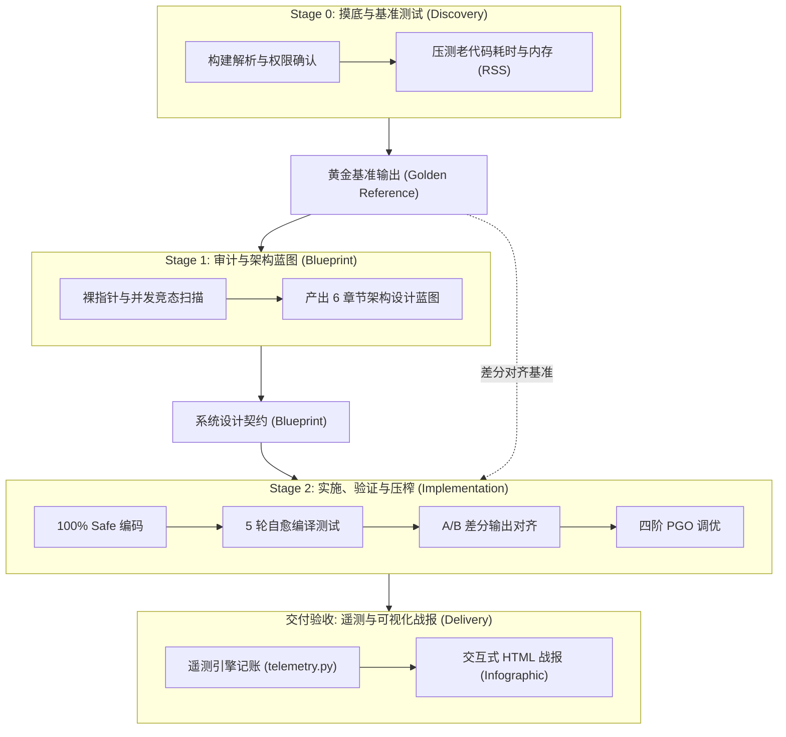
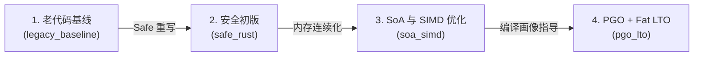

如果要在程序员的心愿单里挑一个呼声最高、却又最令人望而生畏的技术愿望，那一定是把那坨跑了十几年、充满隐患却又不敢碰的 C/C++ 或旧 Python 算法，完完全全重构成现代化、内存绝对安全的 Rust。

随着大语言模型（LLM）与 AI Agent 的爆发，很多人的第一反应是：“直接把老代码一股脑丢给 AI，让它帮我转成 Rust 不就行了？”

但现实往往会给你一记响亮的耳光。

---

## 一、 为什么让普通 AI 翻译 Rust 总是大型翻车现场？

如果你曾经尝试让通用大模型做跨语言重构，大概率遭遇过以下这三大“重构暗礁”：

### 1. 搞不定借用检查，就偷懒滥用 unsafe
Rust 的借用检查器（Borrow Checker）是出了名的严格。当老代码里充斥着原始裸指针、双向链表等环状引用，或是复杂的跨线程共享时，AI 往往因为“智力上下文超限”或缺乏整体设计能力，转而投机取巧，**悄悄套上一层 `unsafe` 块**。  
看似代码编译通过了，但 Rust 最核心的内存安全红利瞬间荡然无存，甚至留下了更隐蔽的未定义行为（Undefined Behavior）。

### 2. 看似跑通了，实际上逻辑暗病丛生
在数值计算与图形学，或是加密与高并发等场景中，跨语言迁移极易出现微小的偏差：
- 浮点数运算顺序变化导致的精度抖动（如 FMA 融合乘加）。
- 伪随机数生成器（PRNG）算法细节不同导致随机种子序列不一致。
- 整数溢出行为（C/C++ 的未定义行为 vs Rust 的 Debug 崩溃 / Release 回绕）。

这些偏差在单元测试不健全的情况下，往往很难在第一时间发现，导致新系统上线后计算结果慢慢“跑偏”。

### 3. 为了过审代码，性能断崖式劣化
为了强行让 Rust 编译器“闭嘴”，缺乏系统级架构能力的 AI 最常用的手段，是 **无脑加入 `.clone()` 与频繁在热点循环中分配堆内存**。  
原本 C/C++ 里毫秒级响应的高频算法，因此被转成了疯狂触发堆内存分配（Heap Allocation）与缓存失效（Cache Miss）的慢速代码，重构完甚至比原先慢了好几倍。

> **核心症结** ：代码重构不是“词汇翻译”。没有严格的工程约束、基准比对与闭环验证，单纯依赖大模型的概率生成，代码迁移注定是在开盲盒。

为了终结这种“碰运气式”的重写，Google 在其官方智能体技能库中开源了 [**`migrate-to-rust`**](https://github.com/google/skills/tree/main/skills/developers/migrate-to-rust) 技能。

---

## 二、 什么是 migrate-to-rust 技能？

在当前的智能体生态中（如 **Antigravity**、**Claude Code**、**Cursor**、**Gemini CLI** 等），**Skill（技能）** 是给 AI 注入的特定领域“专家 SOP 运行手册”。

如果说普通 AI 只是一个拿到需求就提笔狂写的实习生，那么 `migrate-to-rust` 则是**直接给 AI 套上了“资深系统架构师 + 性能调优专家 + Rust 核心开发”的三重职业人格**。

它不仅仅是一段 Prompt，而是定义了一整套跨越项目全生命周期的自动化工程流水线：从摸底基准测试与架构蓝图设计，到 100% Safe 编码、5 轮自愈纠错与 A/B 差分对齐，再到利用 LLVM PGO 压榨性能，最后甚至会为你自动生成交互式 HTML 可视化战报。



---

## 三、 拆解工业级重构流水线

### 阶段 0：摸底与黄金基准捕捉（Discovery & Baseline）

很多自动化工具最大的安全隐患，在于直接在本地默默编译未知仓库。`migrate-to-rust` 在第一步就设计了严谨的 **安全确认关卡（External Code Confirmation Gate）**：

1. **自动识别与安全确认** ：AI 会克隆或读取指定的工程目录，自动分析其构建系统（CMake、Makefile、Cargo、Meson、PyProject 等），并在执行前**明确向用户展示解析出的构建命令、运行命令与工作目录**，必须获得你的授权放行后才开始执行。
2. **捕捉黄金基准（Golden Reference）** ：使用 `-O3` 或 Release 模式构建老系统，测量基准执行时间（毫秒）与峰值内存占用（RSS），并在若干固定的确定性随机种子下捕获标准输出结果。这些数据会被作为后续检验 Rust 版本的绝对标准。

### 阶段 1：深度审计与架构设计蓝图（Architectural Blueprint）

在动笔写任何一行 Rust 代码之前，技能强制要求 AI 进入系统架构师角色，完成全面的代码体检：

- 扫描老代码里的原生指针、手动内存管理（`malloc`/`free`/`new`）、隐式全局变量和并发竞态隐患。
- 产出一份结构严密的 **6 章节架构设计蓝图**：
  1. **系统概述与迁移范围**。
  2. **核心领域模型与类型安全设计**（如何用 Rust 的 Enum、Newtype 模式消除隐式状态）。
  3. **数据导向内存布局规划**（如何将结构体数组 SoA 转化为缓存友好的连续内存）。
  4. **并发与确定性策略**（随机数生成器隔离、无锁数据结构等）。
  5. **错误处理模型**（全面抛弃 C 风格错误码，改用强类型 `Result<T, E>`）。
  6. **逐步实施计划与阶段检查点**。

**谋定而后动**，彻底杜绝了 AI 边写边改、架构散乱的问题。

### 阶段 2：安全重写、自愈测试与性能压榨

这是整个技能最精彩的“硬核战斗阶段”，包含了四大约束与引擎：

#### 1. 强安全铁律：禁止任何 unsafe
在生成的 Rust 项目根目录（`src/lib.rs` 与 `src/main.rs`），技能要求第一行必须强制声明：
```rust
#![forbid(unsafe_code)]
```
这意味着：**哪怕只有一行 `unsafe`，编译器就会直接报错中断**。AI 没有任何偷懒借口，必须用合法的安全所有权、切片（Slices）与强类型抽象来重构原先的裸指针逻辑。

#### 2. 代码卫生与模块解耦
技能对代码可维护性有着严苛的量化红线：
- **单文件代码行数 `<= 400` 行**（硬性天花板 600 行），逼迫 AI 将几千行的巨石老文件解耦为职责清晰的微模块。
- 强制为所有公有接口提供详尽的 `rustdoc`（`//!` 与 `///`），并且必须附带 **可运行的文档测试（Doc-tests）**。

#### 3. 5 次自动自愈熔炉（The Verification Crucible）
写完代码后，AI 会自动运行 `cargo test` 和 `cargo clippy`。一旦出现编译报错或单测失败：
- 它不会停下来向你抱怨，而是立刻进入 **自愈循环（Self-Healing）**。
- 自动抓取编译器诊断与 Panic 调用栈，分析根本原因，修改源码并重新复测。
- 拥有最多 **5 轮自动纠错预算**，力求自主达到零警告与零报错，且分支覆盖率 `>= 95%` 的极限标准。

#### 4. A/B 差分输出对齐（Parity Harness）
代码能跑通，怎么保证逻辑和原版一模一样？技能内置了 A/B 差分检验机制：
- 在多个确定性种子下，同时执行老程序与新编译的 Rust 程序。
- 对比两者的输出数据流，如果在允许的容差（`--max-abs-error`）之外产生任何差异，AI 会自动进行二分定位（Bisect），排查是哪一步算法出现了数值发散，修平差异后再重新对齐。

---

## 四、 性能四阶梯（Performance Staircase）与 PGO 调优

很多开发者会问：“用安全 Rust 重构后，性能真的能媲美甚至超越原先高度优化的 C/C++ 吗？”

`migrate-to-rust` 给出了解法，通过清晰的四阶段性能天梯逐步压榨算力：



1. **阶梯 1：老代码基线（`legacy_baseline`）** ：测量原版在 `-O3` 下的速度与内存，作为 1.0x 参照系。
2. **阶梯 2：安全初版（`safe_rust`）** ：纯 Safe Rust 实现，核心任务是保证正确性，并杜绝热点循环中多余的堆分配。
3. **阶梯 3：数据导向与自动向量化（`soa_simd`）** ：
   - 将“对象数组（Array of Structures）”重构成“结构体数组（Struct of Arrays）”。
   - 保证数据在内存中紧凑排列，让 CPU L1/L2 缓存命中率拉满，并主动诱导 LLVM 触发 SIMD 指令并行计算。
4. **阶梯 4：采样引导优化（`pgo_lto`）** ：
   - 启用 LLVM 的 **PGO（Profile-Guided Optimization）** 编译流水线：先构建插桩二进制文件（`-Cprofile-generate`），输入代表性负载跑一轮收集热点路径画像。
   - 用 `llvm-profdata` 合并画像数据，并在二次编译时引入画像（`-Cprofile-use`）。
   - 配合跨模块的 **全局胖链接时优化（Fat LTO）** 与 `codegen-units = 1`，消除内联屏障，释放硬件的最后一滴性能潜力。

---

## 五、 全流程遥测与交互式可视化战报

传统 AI 重构代码，过程像个黑盒子。而 `migrate-to-rust` 自带了一套 Python 遥测引擎（`scripts/telemetry.py`），全流程都在记账：

- 哪个模块重写耗时最长？
- 单元测试经历了多少次自愈才通过？
- 代码行数、注释密度、圈复杂度发生了什么变化？
- 四个性能阶段的耗时与内存分别下降了多少？

任务完成后，它会自动为你渲染出一份令人惊艳的 **交互式 HTML 战报（`migration_infographic.html`）**！报告里不仅有直观的雷达图、前后性能对比柱状图，还附带了一篇以第一人称 AI 工程师口吻撰写的重构叙事小说，详尽复盘整个攻坚过程中的架构抉择与踩坑记录。

---

## 六、 如何安装与使用 migrate-to-rust？

无论你使用的是 **Antigravity**、**Claude Code**、**Cursor** 还是 **Gemini CLI**，安装该技能都非常简单。

### 方法一：使用官方通用包管理器安装（推荐、全自动）

Google Skills 仓库原生集成了通用的 [skills.sh](https://skills.sh) 跨 Agent 包管理器。你只需要在终端中运行一条命令：

#### 1. 仅对当前项目生效
在你的项目根目录下执行：
```bash
npx skills add google/skills -s migrate-to-rust
```

#### 2. 全局安装（本机所有项目均可用）
如果你希望以后任何项目随时随地都能召唤它，加上 `-g` 参数：
```bash
npx skills add google/skills -s migrate-to-rust -g
```

> **说明** ：`npx skills` 会自动探测当前机器上的 Agent 工具（如 Antigravity 或 Claude Code），并自动完成目录映射与符号链接，无需手动配置。

---

### 方法二：手动安装（无 Node.js / npx 环境）

Agent Skill 的本质是一个规范化的目录（包含 `SKILL.md` 和辅助脚本）。如果你更倾向于手动放置：

#### 1. 目录位置参考
- **Antigravity / Gemini CLI** ：
  - 项目级：`<项目根目录>/.agents/skills/migrate-to-rust/`
  - 全局级：`~/.gemini/config/skills/migrate-to-rust/`
- **Claude Code** ：
  - 项目级：`<项目根目录>/.claude/skills/migrate-to-rust/`
  - 全局级：`~/.claude/skills/migrate-to-rust/`

#### 2. 一键拉取命令（以 Antigravity 项目级为例）
```bash
# 1. 创建本地技能目录
mkdir -p .agents/skills

# 2. 稀疏克隆该特定技能
git clone --depth 1 --filter=blob:none --sparse https://github.com/google/skills.git /tmp/google-skills
(cd /tmp/google-skills && git sparse-checkout set skills/developers/migrate-to-rust)

# 3. 复制到技能库并清理
cp -r /tmp/google-skills/skills/developers/migrate-to-rust .agents/skills/
rm -rf /tmp/google-skills
```

---

### 如何触发与使用？

安装完成后，开启新的对话或重启会话，直接向 AI 提出迁移需求即可：

> **“请使用 migrate-to-rust 技能，把当前目录下的 C++ 核心算法模块完整重构成 Safe Rust。”**  
> 或者：  
> **“帮我把 https://github.com/xxx/yyy 迁移到 Rust，并生成性能对比战报。”**

你会看到 AI 按照标准的流水线展开工作：主动向你确认运行命令、摸排基准、生成蓝图、编写 100% Safe 代码、自愈纠错并最终奉上性能战报。

---

## 七、 总结：从“概率生成”到“严谨工程”

在 LLM 出现之前，大规模跨语言重构是让无数技术负责人望而却步的高成本苦活。早期的 AI 编程助手，又因为不可控的幻觉与代码暗病，常常沦为“写得快、修得慢”的玩具。

Google 的 **`migrate-to-rust`** 给我们展示了 **智能体工程（Agentic Engineering）** 的未来形态：
- 不仅仅给模型下发提示词，而是为它提供 **完备的约束铁律**（`forbid(unsafe)`、代码行数上限）。
- 为模型配备 **闭环的验证工具**（编译自愈、A/B 差分）。
- 为模型制定 **量化的性能阶梯**（SoA/SIMD 与 PGO）。

只有当 AI 的代码产出被置于如此严谨的工程闭环之下时，我们才能放心地把那些承载着核心业务的遗留代码，交付给智能体去焕发新生。
