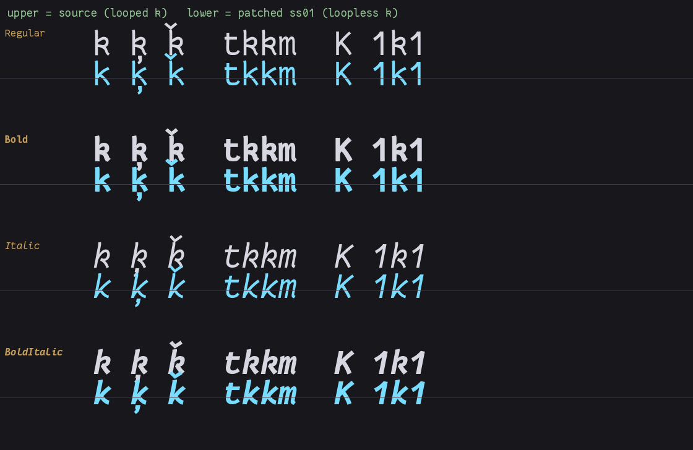

Fantasque Sans Mono 的小写 `k` 在升部带一个手写风格的圆环。字体自带一个叫 `ss01` 的 OpenType 特性，可以把它换成规整的直腿 `k`：在 [Ghostty](https://ghostty.org/docs/config/reference) 里这是一行配置（`font-feature = ss01`），在 [WezTerm](https://wezterm.org/config/lua/wezterm/font.html) 里写进字体对象的 `harfbuzz_features` 即可。但我想继续用 Alacritty。

**Alacritty 0.17.0 的 `[font]` 段没有任何 OpenType 特性开关，`ss01` 这类默认关闭的特性只能烘进字体文件的轮廓里**。本文记录从“确认没有开关”到“产出 4 个字重的补丁字体并接入配置”的全过程：差分探针怎么做、Nerd Fonts 构建里藏着一条怎样的坏规则、TrueType phantom 点踩了什么坑，以及 120 项校验断言。所有数字来自本机实测（macOS、Alacritty 0.17.0、Nerd Fonts 3.5.1 构建，首测于 2026-09-28），不是文档转述。

## 确认“没有开关”：先证明探针抓得住失败

Alacritty 对无法识别的配置键只打警告、不报错，写一个不存在的键，它照样正常启动。这意味着“写了 `features = ["ss01"]` 没报错”完全不能当作生效的证据，很容易让人以为开关存在。所以第一步是先做个探针，把“键不存在”和“键存在但值写错了”区分开。

方法是写一份只含待测键的配置，跑一次 `alacritty -vv -e /usr/bin/true`（子进程立刻退出，窗口一闪而过），看日志里的两种输出：

| 日志 | 含义 |
| --- | --- |
| `[WARN ] [alacritty_config_derive] Unused config key: X` | 键不存在，被静默忽略 |
| `[ERROR] [alacritty_config_derive] Config error: X: invalid type ...` | 键存在，但值的类型写错了 |

实测结果（`/Applications/Alacritty.app/Contents/MacOS/alacritty`，`CFBundleShortVersionString = 0.17.0`）：

```text
[font] features = ["ss01"]   -> Unused config key: features
[font] zzz_bogus_key = 1     -> Unused config key: zzz_bogus_key
```

`features` 与一个乱造的键反应完全一致：它不存在。[官方配置文档](https://alacritty.org/config-alacritty.html)可以交叉确认：`[font]` 段只接受 `size`、`offset`、`glyph_offset`、`builtin_box_drawing` 和 `normal` / `bold` / `italic` / `bold_italic` 四个子表，没有任何特性开关。

顺手把整个段扫了一遍：`use_thinning`、`raw_line_height`、`[font.light]`、`[font.medium]` 等也都是未知键。字重槽位只有 4 个，这是终端属性模型决定的。终端的属性序列（SGR）只有 bold 与 italic 两个开关，组合出四种渲染状态，寻址不了第五种。faint/dim（`ESC[2m`）走的是颜色（`colors.primary.dim_foreground` 实测可认），不是字重。

这套探针的原则后面还会用到：**“没有报错”不是证据；先让探针对一个已知失败的输入给出预期的反应，“没有警告”才开始算证据**。

## ss01 在这个字体里是什么：以及一条坏规则

补一句背景：OpenType 字体可以内置一组替换规则（GSUB 表），特性标签是这些规则的开关。`ss01` 即 Stylistic Set 1（[OpenType 特性注册表](https://learn.microsoft.com/en-us/typography/opentype/spec/featurelist)），默认关闭，由排版引擎在被显式启用时应用。

用 [fontTools](https://github.com/fonttools/fonttools) 4.63.0 直接读 GSUB。源文件是 `~/Library/Fonts/FantasqueSansMNerdFont-{Regular,Bold,Italic,BoldItalic}.ttf`，[Nerd Fonts](https://github.com/ryanoasis/nerd-fonts) 3.5.1 构建，上游 `Version 1.8.0`（作者 Jany Belluz，[fantasque-sans](https://github.com/belluzj/fantasque-sans)），`unitsPerEm = 2048`，Regular 有 11911 个字形。用下面这段命令即可列出特性标签并展开 `ss01` 的替换映射：

```bash
python3 - <<'PY'
from fontTools.ttLib import TTFont
f = TTFont("/Users/alex/Library/Fonts/FantasqueSansMNerdFont-Regular.ttf")
t = f["GSUB"].table
print(sorted({r.FeatureTag for r in t.FeatureList.FeatureRecord}))
for r in t.FeatureList.FeatureRecord:
    if r.FeatureTag == "ss01":
        for li in r.Feature.LookupListIndex:
            for st in t.LookupList.Lookup[li].SubTable:
                print(getattr(st, "mapping", {}))
PY
```

各字重的特性集合与 `ss01` 的全部规则：

| 文件 | 特性 | ss01 规则 |
| --- | --- | --- |
| Regular | `calt, ss01` | `k→k.noloop`、`ķ→kcommaaccent.noloop`、`ǩ→pom-away` |
| Bold | `calt, mark, ss01` | 同上 |
| Italic | `calt, locl, ss01` | 前两条同上，第三条指向 `pom-external_interruption` |
| BoldItalic | `calt, locl, mark, ss01` | 同 Italic |

也就是说，这个字体的 `ss01` 只是去掉 `k` 升部的环（`ķ` 跟着变）。`calt`（上下文交替）默认就是开的，Alacritty 已经在应用它。

**第三条规则是坏的**。原字体里根本不存在 `uni01E9.noloop` 字形，而 GSUB 的 lookup 按字形**索引**引用。Nerd Fonts 合并图标后索引被重新解释，`ǩ` 的替换目标落到了 U+E007 的 Pomicons “away” 火焰图标上。证据链：

```text
uni01E9 -> pom-away   bbox=(0,-181,1465,1433)  30 ops / 48 pts   码位 U+E007
k       -> k.noloop   bbox=(112,-23,981,1427)  15 ops / 26 pts   码位 U+E005
ķ       -> kcommaaccent.noloop                 1060 adv          码位 U+E006
```

`pom-*` 是 Pomicons 的命名前缀，且这三只字形各自占着私用区（PUA）码位。同一批污染还导致 `U+E005` / `U+E006` 这两个本该是 Pomicons 图标的码位，现在画出来是 k 的形状。

这条坏规则改变了“换个终端就好”的取舍。在 Ghostty 里对这个 Nerd Font 开 `ss01`，`k` 确实会变直，但文档里一旦出现 `ǩ`，就会烧出一个火焰图标。问题出在字体构建里，不在终端里。

## 取舍：搬轮廓，而不是搬开关

- **不换终端，改字体**。目标是留在 Alacritty，配置层无解，就只能在字体层面解决。
- **搬轮廓，而不是把 ss01 挂到 `calt` 上**。后者改动更小，但依赖“排版器一定应用 calt”这个假设；直接替换轮廓不依赖任何排版行为，确定性最高。
- **跳过 `ǩ` 那条规则**。它的目标已经是图标，烘进去只会把 `ǩ` 变成火焰。
- **删掉整条 `ss01` 特性记录**。留着的话，任何支持特性的排版器（比如 Ghostty 或浏览器、编辑器）都可能再触发那条坏规则，删掉后 `ss01` 成为空操作。
- **产出新 family，不覆盖原字体**。可与原字体并存、随时回滚，也便于对比。

## 三步改字体

环境是 python3 加 fontTools。下面三个函数加上本节末尾的组装循环，就是完整的生成逻辑。

### 1. 搬轮廓：小心 phantom 点

```python
def bake_pair(font, src_name, alt_name):
    """把 alt_name 的轮廓搬进 src_name，并保持 advance 与正确的 lsb。"""
    glyf = font["glyf"]
    glyf.ensureDecompiled()          # 保证坐标/部件已展开，deepcopy 才搬得干净
    if src_name not in glyf or alt_name not in glyf:
        raise SystemExit("缺少字形: %s / %s" % (src_name, alt_name))

    src_adv = font["hmtx"][src_name][0]
    alt_adv = font["hmtx"][alt_name][0]
    if src_adv != alt_adv:
        raise SystemExit("advance 不一致，等宽终端里会串列，拒绝继续")

    # TrueType 简单字形存的是绝对坐标，整只搬过去不需要平移；复合字形部件按名字解析。
    glyph = copy.deepcopy(glyf[alt_name])
    glyf[src_name] = glyph

    # 关键：先算出这只字形自己的 xMin，再把 hmtx 的 lsb 写成同一个值。
    glyph.recalcBounds(glyf)
    x_min = int(round(glyph.xMin))

    # 守卫一：搬进来的轮廓必须仍落在 head 记录的全局边界框内，否则得重算全局范围。
    head = font["head"]
    if not (head.xMin <= x_min and int(round(glyph.xMax)) <= head.xMax):
        raise SystemExit("%s 超出 head bbox，需要重算全局边界" % src_name)
    font["hmtx"].metrics[src_name] = (src_adv, x_min)

    # 守卫二：逐点比对坐标，确认搬干净了（getCoordinates 不走 phantom 偏移，读数是干净的）。
    if glyf[src_name].getCoordinates(glyf)[0] != glyf[alt_name].getCoordinates(glyf)[0]:
        raise SystemExit("%s 与 %s 轮廓不一致" % (src_name, alt_name))
    return src_adv, x_min
```

**这里踩了一个真坑**。第一版用 `BoundsPen` 通过 `font.getGlyphSet()` 量边界来定 `lsb`，产出的 `k` 得到 `lsb=113`，而字形自己的 `xMin=112`。逐点坐标其实完全一致，差的是 phantom：TrueType 的左 phantom 点要求 `lsb == xMin`，一旦不等，渲染器会按 `(lsb - xMin)` 把整只字形横向平移，而 `getGlyphSet()` 画图时**已经带着这个偏移**，所以用它量出来的 `xMin` 本身就是被污染过的读数。改成先 `glyph.recalcBounds(glyf)` 拿权威 `xMin`、再把同一个值写进 `hmtx` 后，两者之差归零，并在校验里把 `lsb == xMin` 固化为一条断言。

各字重烘完后的 `lsb`：Regular 112、Bold 110、Italic 61、BoldItalic 59；`advance` 全部保持 1060 不变。等宽字体里 advance 一变就会串列，所以函数在两者 advance 不一致时直接拒绝继续。

### 2. 摘掉 ss01 特性记录

删 `FeatureRecord` 必须同步重排 `FeatureIndex`，否则 ScriptList 里的引用会指错位置：

```python
def drop_feature(font, tag):
    for table_name in ("GSUB", "GPOS"):
        tbl = font.get(table_name)
        if tbl is None:
            continue
        gsub = tbl.table
        records = gsub.FeatureList.FeatureRecord
        keep = [i for i, r in enumerate(records) if r.FeatureTag != tag]
        if len(keep) == len(records):
            continue
        remap = {old: new for new, old in enumerate(keep)}

        def fix(lang_sys):
            if lang_sys is None:
                return
            idxs = list(getattr(lang_sys, "FeatureIndices", []) or [])
            lang_sys.FeatureIndices = [remap[i] for i in idxs if i in remap]
            lang_sys.FeatureCount = len(lang_sys.FeatureIndices)
            req = getattr(lang_sys, "RequiredFeatureIndex", 0xFFFF)
            lang_sys.RequiredFeatureIndex = remap.get(req, 0xFFFF)

        # DefaultLangSys 挂在每个 Script 表下（可能为 None），ScriptList 顶层没有这个字段。
        for sr in gsub.ScriptList.ScriptRecord:
            fix(getattr(sr.Script, "DefaultLangSys", None))
            for lr in sr.Script.LangSysRecord:
                fix(lr.LangSys)
        gsub.FeatureList.FeatureRecord = [records[i] for i in keep]
        gsub.FeatureList.FeatureCount = len(gsub.FeatureList.FeatureRecord)
```

注意 `DefaultLangSys` 只存在于每个 `ScriptRecord.Script` 下（可能为 `None`），外层 `ScriptList` 本身没有这个字段。“把文章代码抽出来重跑”的自检曾在这里抓出原脚本的一行死代码，见校验一节。

### 3. 改 name 表，保住 style linking

```python
def set_name(name_table, name_id, value):
    """就地替换某个 nameID 的全部记录，保留原有 platform/encoding/lang 组合。"""
    tuples = sorted({(r.platformID, r.platEncID, r.langID)
                     for r in name_table.names if r.nameID == name_id})
    name_table.names = [r for r in name_table.names if r.nameID != name_id]
    if not tuples:
        tuples = [(1, 0, 0), (3, 1, 0x409)]
    for pid, eid, lid in tuples:
        name_table.setName(value, name_id, pid, eid, lid)
```

用它改写 `1`(family)、`2`(style)、`3`(unique)、`4`(full)、`5`(version 追加烘焙日期)、`6`(postscript)。两条边界：

- 源字体没有 `16/17`（typographic family/style），就不新增，避免改变 CoreText 的家族归组行为。
- **绝对不动** `OS/2.usWeightClass`、`OS/2.fsSelection`、`head.macStyle`。Regular/Bold/Italic/Bold Italic 四个字重靠这三个字段做 style linking，动了 bold/italic 就选不中了。

新 family 定为 `FantasqueSansM NF ss01`；PostScript 名 `FantasqueSansM-NFss01-<Style>`，无空格、与原字体不撞名。

### 4. 组装

```python
import copy
import datetime
import os

from fontTools.ttLib import TTFont

SRC_DIR = os.path.expanduser("~/Library/Fonts")
NEW_FAMILY = "FantasqueSansM NF ss01"
STAMP = datetime.date.today().isoformat()

# (源文件, style, 输出文件名, PostScript 名)
WEIGHTS = [
    ("FantasqueSansMNerdFont-Regular.ttf", "Regular",
     "FantasqueSansM-NFss01-Regular.ttf", "FantasqueSansM-NFss01-Regular"),
    ("FantasqueSansMNerdFont-Bold.ttf", "Bold",
     "FantasqueSansM-NFss01-Bold.ttf", "FantasqueSansM-NFss01-Bold"),
    ("FantasqueSansMNerdFont-Italic.ttf", "Italic",
     "FantasqueSansM-NFss01-Italic.ttf", "FantasqueSansM-NFss01-Italic"),
    ("FantasqueSansMNerdFont-BoldItalic.ttf", "Bold Italic",
     "FantasqueSansM-NFss01-BoldItalic.ttf", "FantasqueSansM-NFss01-BoldItalic"),
]
BAKE = [("k", "k.noloop"), ("kcommaaccent", "kcommaaccent.noloop")]

for source, style, out_name, ps_name in WEIGHTS:
    font = TTFont(os.path.join(SRC_DIR, source))
    for src_name, alt_name in BAKE:
        bake_pair(font, src_name, alt_name)
    drop_feature(font, "ss01")
    name = font["name"]
    set_name(name, 1, NEW_FAMILY)
    set_name(name, 2, style)
    set_name(name, 3, "%s %s;ss01-baked;%s" % (NEW_FAMILY, style, STAMP))
    set_name(name, 4, "%s %s" % (NEW_FAMILY, style))
    set_name(name, 5, "%s; ss01 baked %s" % (name.getDebugName(5), STAMP))
    set_name(name, 6, ps_name)
    font.save(out_name)
```

跑完得到 4 个各约 2.6 MB 的 ttf。源文件全程只读。

## 校验：120 项断言加三层旁证

### 结构断言

校验脚本用 `TTFont(..., lazy=False)` 强制全表解一遍（等于让 fontTools 自己验收），再逐项比对，每个字重 30 项、共 120 项，任何一条不过就 exit 1：

- 形状：`k` 逐点轮廓 == 原 `k.noloop`，且 != 原 `k`（证明真的换了）；`ķ` 同理。
- 未受影响：`a`、`x`、`W`、`zero`、`equal`、`uni01E9` 等 8 个对照字形逐点 == 原字体。
- phantom：`k`、`ķ` 的 `lsb == xMin`。
- 度量：全表 `advance` 一个都没变；`hmtx` 条目数一致。
- 映射：`cmap` 码位到字形完全一致；字形顺序（索引）与 `numGlyphs` 一致。
- 特性：`ss01` 已消失，没有多出别的特性；`ǩ` 不再有任何单形替换，`k` 也不被其他单形替换改写。
- 完整性与命名：无悬空复合部件引用；nameID 正确且 Mac 与 Windows 两个平台都有 family 记录；style linking 三字段未动。

### 肉眼验收：渲染对比

用 Pillow（FreeType 后端）把四个字重的源字体与补丁版成对渲染出来（测试串 `k ķ ǩ  tkkm  K 1k1`，上排源字体灰白、下排补丁版青色）：



上排 `k` 带环，下排无环；`ķ` 与 `ǩ` 的附加符号正常保留，大写 `K` 不受影响。注意下排的 `ǩ` 仍是带环的原字形而不是火焰图标：这正是跳过那条坏规则的预期结果，它为什么不能无环见文末边界一节。

### Alacritty 侧：差分测试

复用第一节的探针原则，先证明这套探针抓得住失败。故意用一个不存在的 family：

```text
[WARN ] [crossfont] Unable to load specified font Totally Bogus Family 9x, falling back to Menlo
```

再用新 family：只有 `[DEBUG] [alacritty] Loading "FantasqueSansM NF ss01" font`，零警告，说明 CoreText 确实解析到了。用改好的真实配置（含主题 import）整跑一遍同样无任何字体警告。fontconfig 侧交叉确认：`fc-match "FantasqueSansM NF ss01"` 命中 `FantasqueSansM-NFss01-Regular.ttf`。

### 把文章代码抽出来重跑

把本文的 4 个 Python 代码块从 Markdown 里正则抽出来按顺序 `exec`（组装块自带导入与循环），从原始字体重建 4 个字重，再与已安装的产物逐一对比：逐字形坐标序列与 `hmtx`、`cmap` 完全一致，特性集合和 `nameID 1` 也零差异（Regular 为 11911 只字形）。这段抽取自检在本文发布前又重跑了一遍，结论不变。

这一步还抓到了原脚本里的一行死代码。`drop_feature` 最初在 `ScriptList` 顶层也写了一句 `getattr(gsub.ScriptList, "DefaultLangSys", None)`，手抄进文档时被简化成 `gsub.ScriptList.DefaultLangSys`，一跑直接抛出 `AttributeError`。回头查表结构才发现 `DefaultLangSys` 属于下一层的 `Script` 表，`ScriptList` 顶层从来没有这个字段，原脚本只是被 `getattr(..., None)` 静默吞掉了错误，直接删掉那行即可。

### 没做成的检查

想再用 `alacritty --ref-test` 拿一张 Alacritty 自身 GPU 管线的出图作为最终证据，但那一次把子进程接在 stdin 上导致挂起，已终止。所以缺一张终端内实际渲染的截图，屏幕观感需重启 Alacritty 后自行确认。

## 安装、配置与回滚

```bash
cp -p FantasqueSansM-NFss01-*.ttf ~/Library/Fonts/
```

`~/.config/alacritty/alacritty.toml` 的 `[font]` 段只改 4 处 `family`，其余原样：

```toml
[font]
size = 16.0

# family 用的是自制补丁版 "FantasqueSansM NF ss01"：Alacritty 0.17 的 [font] 段没有
# 任何 OpenType 特性开关（写 features = ["ss01"] 只会得到 "Unused config key" 警告），
# 所以把 ss01（无环 k）直接烘进了字形轮廓。
# 回滚：下面 4 处 family 改回 "FantasqueSansM Nerd Font"，再删掉
# ~/Library/Fonts/FantasqueSansM-NFss01-*.ttf 即可，原字体未被改动。

[font.normal]
family = "FantasqueSansM NF ss01"
style = "Regular"

[font.bold]
family = "FantasqueSansM NF ss01"
style = "Bold"

[font.italic]
family = "FantasqueSansM NF ss01"
style = "Italic"

[font.bold_italic]
family = "FantasqueSansM NF ss01"
style = "Bold Italic"
```

**必须重启 Alacritty**，已开着的窗口不会换字体。

回滚就三步：4 处 `family` 改回 `"FantasqueSansM Nerd Font"`；删除 `~/Library/Fonts/FantasqueSansM-NFss01-*.ttf`；重启。源字体文件全程只读，事后复核过这 4 个文件的 mtime 与特性集合（`ss01` 仍在）均未改变。

## 边界与遗留

- `U+E005` / `U+E006` 这两个 Pomicons 码位在源字体里就被 k 变体字形占着，本次没碰；补丁版里它们仍是无环 k，与现状一致。
- `ǩ` 的无环变体在原字体里已经丢失，只能保持带环。
- 只做了 `FantasqueSansM Nerd Font`；`Mono` / `Propo` 两个变体没做。需要的话往 `WEIGHTS` 里每个变体补 4 条重跑即可，`BAKE` 规则通用，已确认 12 个字体文件里 `ss01` 的输入字形集合完全相同（`k`、`kcommaaccent`、`uni01E9`）。但一定要换 `NEW_FAMILY`，否则会和已装的 4 个字重撞同一个 family 名。
- 补丁版仍是 4 个字重、无 `fvar` 可变轴。Alacritty 的字重槽位上限是 4，这是终端协议层的限制，不是字体问题。
- 日后升级 Alacritty，`use_thinning` / `raw_line_height` 这类键的接受情况可能变化，用第一节的探针重测即可，几分钟的事。

这套做法不限于 `ss01`：任何默认关闭的特性，只要字体里存在对应的变体字形、advance 一致，都可以同样烘进去。本例额外多出的只有一步，就是烘之前先确认替换规则本身还指向它该指向的地方。图标字体合并字形之后，索引引用可能悄悄指向别处。若哪天 Alacritty 加上了特性开关，这套补丁可以按上面三步整体退役。在那之前，它是留在 Alacritty 里最确定的一条路。
