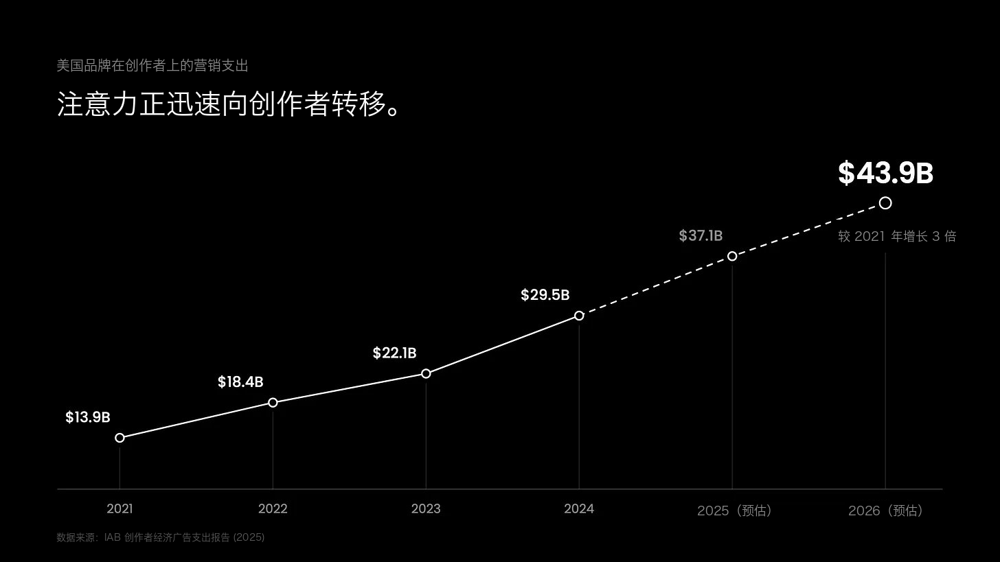
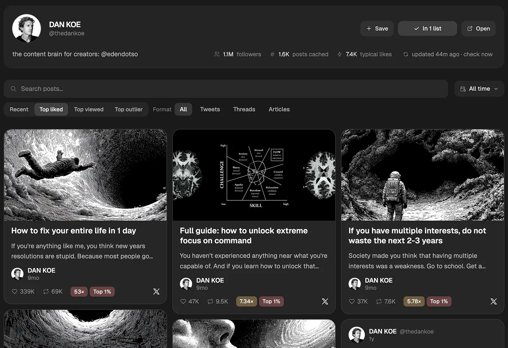
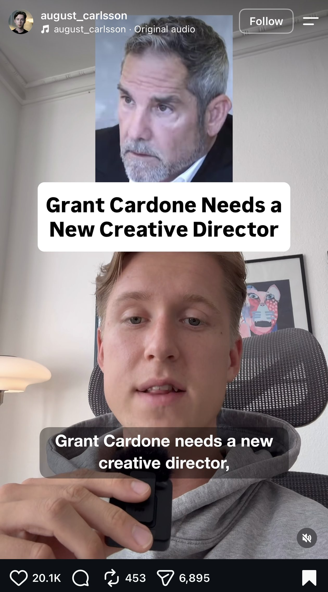

> **作者：** DAN KOE ([@thedankoe](https://x.com/thedankoe))  
> **来源：** [X (Twitter) 文章](https://x.com/thedankoe/status/2117664712532123680)  
> **发布日期：** 2026 年 11 月 5 日  
> **阅读时长：** 约 18 分钟（约 3,680 词）

> **导读：900 : 99 : 1 的注意力真相**  
> 读完这篇在 X 上广为流传的爆文，我的第一反应是觉得它很“虚”。在我的观察里，真实的创作者经济遵循着残酷的比例：**1,000 个人下场创作内容，往往有 900 人颗粒无收，99 人只能拿到微薄的辛苦钱，只有站在金字塔尖的 1 个人大赚特赚**。  
> 
> 下面保留了 Dan Koe 原文的中英双语逐段对照，并在四个章节末尾附上了**我的祛魅批注**。不妨把这篇文章当作一个双层样本来读：一层看海外头部“一人公司”博主如何利用宏观数据、焦虑叙事和简化版 Prompt 搭建一套精密的“卖铲子”销售漏斗；另一层则剥掉它“月入数万美金”的营销糖衣，把第三部分那套真正扎实的“思想指纹”访谈清单和内容结构化方法留为己用。

---

The most lucrative skill has always been capturing attention.

有史以来最值钱的技能，永远是吸引注意力。

It’s obvious why.

原因显而易见。

If your goal is making more money, it doesn’t matter how good a software you build. It doesn’t matter if it took you 3 years and endless scrapped drafts to write a book. It doesn’t matter if you work hard and improve yourself to increase your career opportunities.

如果你的目标是赚更多钱，那么你开发出的软件有多出色其实并不重要；哪怕你耗费 3 年、历经无数报废草稿才写出一本书，也不重要；就算你拼命工作、自我提升以寻求更好的职业发展机会，同样无关紧要。

If nobody knows who you are or what you offer, how in the world are they going to pay you?

要是压根没人知道你是谁、能提供什么，他们到底要怎么付钱给你？

Meaning, whatever your work is or whatever business you build, capturing attention and acquiring customers will be the primary thing that determines your success.

换句话说，无论你从事何种工作，或打算创办什么样的业务，捕捉注意力并获取客户，都是决定成败的关键命脉。

This applies to both your own business and others’ businesses.

这不仅适用于你自己的业务，同样适用于别人的业务。

And other people will pay top dollar for you to do it for them.

只要你能帮别人做到这一点，他们绝对愿意为你开出天价报酬。

As job security goes down, people are met with 3 options:

随着职场稳定度每况愈下，摆在人们面前的通常有三条路：

1. Complain about how life is unfair and do nothing
2. Upskill and reeducate to find a better job opportunity
3. Start building the business you’ve always wanted to build

1. 抱怨命运不公，然后原地躺平
2. 提升技能并重塑知识体系，寻找更好的工作机会
3. 动手打造那个自己一直梦寐以求的商业项目

An absurd amount of people will choose option 3.

会有惊人数量的人毅然选择第三条路。

As you could guess, and as everyone is screaming about on social media, the way they will build that business is by starting a personal brand.

正如你所预料的那样，也正如所有人在社交媒体上大声呼吁的那样：他们搭建业务的核心路径，就是打造个人品牌。

Why?

为什么？

Because attention is a finite resource, and it’s only becoming more scarce. People can make more money, but they will never get back the attention they spent.

因为注意力是有限的稀缺资源，而且只会越来越稀缺。钱可以再赚，但花掉的注意力永远无法收回。

In this letter, I will show you how to master attention capture on social media. That way, at least for the next few years, you won’t have an issue making money.

在这篇长文里，我将向你揭示如何在社交媒体上掌握掌控注意力的底层逻辑。只要掌握了它，至少在接下来的几年里，赚钱对你来说绝非难事。

With what you learn, you can start your own business using social media to fuel it, or become a “one person creative team” for other companies that will pay top dollar for your skill set.

学完这些内容后，你可以借助社交媒体的杠杆启动属于自己的业务，也可以作为“一人创意团队”为其他企业赋能，而他们会为你的这项能力支付极为丰厚的回报。

Promo - Workshops for the Second Renaissance:

推广 —— 第二次文艺复兴工作坊（Workshops for the Second Renaissance）：

I’m teaming up with Hussain Ibarra (grew from 2,600 to 20,100 Substack subs) to teach newsletter and article writing that people actually want to read.

我正与 Hussain Ibarra（他的 Substack 订阅量从 2,600 暴涨至 20,100）携手合作，传授真正能吸引受众阅读的通讯周刊与长文写作技巧。

If you’ve considered building a Substack, or want to write better X articles, [sign up here](https://eden.so/workshop), it’s $49 but will teach you the skills to make far more than that.

如果你曾考虑过运营 Substack，或是希望在 X 上写出更有质感的深度长文，欢迎[点击此处报名](https://eden.so/workshop)，课程售价 49 美元，但它带给你的技能收益将远超这笔投入。

## 第一部分：要么成为创作者，要么雇佣创作者，要么为创作者打工（I – You Will Either Become a Creator, Pay a Creator, or Get Paid to Work for a Creator）

The data is almost too hard to ignore.

现实中的数据已经确凿到无法忽视。

Goldman Sachs predicts the creator economy will nearly double, from $250 billion in 2023 to $480 billion by 2027.

高盛（Goldman Sachs）预测，创作者经济的规模将实现翻倍，从 2023 年的 2,500 亿美元跃升至 2027 年的 4,800 亿美元。

In 2025, creators earned about $185 billion in ad revenue, which is the first year they passed traditional media.

2025 年，创作者群体斩获约 1,850 亿美元的广告收入，历史上首次超越传统媒体。

US brands spent $13.9 billion on creators in 2021, and the IAB expects that to reach $43.9 billion in 2026, which is about 3x in 5 years.

美国品牌在 2021 年向创作者投入了 139 亿美元，而美国互动广告局（IAB）预计这一数字在 2026 年将攀升至 439 亿美元，短短 5 年内翻了 3 倍之多。

Absurd.

令人震撼。

And as someone who both is a creator, has worked for creators, and pays creators, the prices people charge are crazy. There is an absurd amount of VC money being thrown around, paying thousands of dollars for a single reel or 60-second YouTube time slot (that don’t even bring results 90% of the time).

作为一个本身是创作者、曾为创作者工作过、同时也向创作者支付费用的圈内人，行业内的报价简直让人瞠目结舌。大量风投资金正在四处挥洒，动辄为一条短视频（Reel）或 60 秒的 YouTube 贴片广告支付数千美元（哪怕其中 90% 的投放根本带不来实际回报）。

The point is that social media is where the attention is. Not the radio, TV, or news anymore. When you want to start any kind of business - from lifestyle business talking about your interests to the next unicorn startup, posting content is almost a given at this point for how you attract an audience that pays you.

核心逻辑在于：受众的注意力全部聚集在社交媒体上。收音机、电视或传统新闻早已不是注意力的中心。当你想要启动任何类型的业务时 —— 无论是聊聊个人兴趣的生活方式类小生意，还是下一家独角兽初创企业 —— 发送内容都已经成为吸引付费受众的不二法门。

When companies want to expand, they put millions of dollars into affiliate and partnership campaigns. I keep getting ads from Hormozi saying they pay over a million a month to creators to promote Skool. And that’s aside the fact the Hormozi is a creator, which massively helps grow Skool.

当企业寻求规模扩张时，他们会在分销联盟与商务合作上豪掷数百万美元。我经常刷到 Hormozi 的广告，称他们每月向创作者支付超过 100 万美元来推广 Skool。更不用说 Hormozi 本人就是顶级创作者，这极大赋能了 Skool 的爆发式增长。

“Founder-led marketing” is now a buzzword in the startup space, which essentially means that the latest and greatest way to grow your startup is... you guessed it, starting a personal brand and posting content (and most of them are horrible at it by the way, and you should probably start using [Eden](https://eden.so/) to research, differentiate yourself, and post).

如今，“创始人主导型营销”（Founder-led marketing）已成为创业圈炙手可热的代名词，其核心本质就是：当下推动初创项目增长最新、最行之有效的路径，正是……你猜得没错，打造个人品牌并输出内容（顺便提一句，他们中绝大多数人的内容做得极其糟糕，或许早就该用 [Eden](https://eden.so/) 来做行业调研、寻找差异化定位并发帖）。

What does this mean for you?

这对你来说意味着什么？

It doesn’t matter if you plan to work for yourself, have a business already, or want to work for another business - the most lucrative skill to learn is capturing attention. When you translate that to the digital landscape, the most lucrative skill is creating content - good content, not infinite slop.

无论你是打算自主创业、经营已有企业，还是想在其他公司工作，最值钱的核心技能永远是获取注意力。投射到数字化世界中，最吸金的技能就是创作内容 —— 是真正优质的高维内容，而不是泛滥成灾的人工智能垃圾信息（Slop）。

Unfortunately, you can master capturing attention, but that doesn’t mean you’ve actually captured it.

遗憾的是，你可能精通吸引注意力的技巧，但并不代表你真正留住了注意力。

Getting a million views on one tweet or reel is useless if the rest of your posts get a thousand views a pop. That signals that your content is decent, but your brand is non-existent. We need both.

如果一条推文或短视频拿到百万级播放，但随后的每条帖子播放量暴跌回一千，这种爆款毫无价值。这只能说明你的单条内容尚可，但你的个人品牌根本不存在。而我们需要二者兼备。

You can try to go viral all the time, which is what most people do (and why most people fail abysmally), or you can build a world of content that people can’t help but explore.

你可以尝试像大多数人那样时刻追逐病毒式传播（这也是大多数人惨遭滑铁卢的根源），或者，你也可以构建一个充满深度与吸引力的内容宇宙，让人忍不住深陷其中、探索到底。

I’ll teach you how to do that.

接下来我就教你如何做到这一点。

---

### 💡 批注 01：4,800 亿大盘的均值错觉与 900 : 99 : 1 幂律

第一部分一上来就抛出高盛和 IAB 的宏观预测：创作者经济规模翻倍至 4,800 亿美元，品牌投放涨到 439 亿美元。这组数字极具煽动性，却巧妙地用**行业总盘子的增长**偷换了**普通个体的入局胜率**。

注意力经济服从极端的**幂律分布**（Power Law，赢家通吃），跟正态分布毫无关系。作者在开篇自己也承认“注意力是有限的稀缺资源”。当 AI 把写文章、做视频的门槛降到接近于零，内容供给在短时间内膨胀了上百倍，但全人类每天能刷手机的总时长依然锁死在 24 小时以内。供给暴增而总注意力恒定，算法只会把流量进一步集中推向金字塔尖的 0.1%（比如文中提到的 Hormozi 或 Dan Koe 本人），底部 90% 的新入局者连被看到的概率都比前 AI 时代更低。拿 4,800 亿的行业总盘子劝普通人入局，就像拿“NBA 球星总薪资创下历史新高”来论证“去打职业篮球是最稳妥的赚钱门路”一样。

---

## 第二部分：一人创意团队（II – The One-Person Creative Team）

There is a massive shift happening in the content space right now.

内容创作领域眼下正在经历一场波澜壮阔的巨变。

I’m the founder of Eden, a tool where creators and digital businesses research viral ideas, plan and schedule their content, sell digital products, and run their email list.

我是 Eden 的创始人。Eden 是一款专为创作者与数字业务打造的一体化工具，涵盖爆款选题挖掘、排期规划、数字产品销售以及邮件通讯分发。

That’s not meant to be a pitch. It’s to point out that we have data about this that almost nobody else has. We know what topics, hooks, and content styles work across billions of posts.

我在这里提到它绝非为了推销，而是想说明一个事实：我们掌握着极少有人拥有的海量数据。在分析了数十亿条帖子后，我们清楚知道什么样的选题、开头钩子（Hook）以及内容风格能在全网产生实际成效。

Aside that, freelancers and [agencies](https://eden.so/agencies) use it to run their clients’ personal brand, from content to email marketing to digital product launches and building funnels.

不仅如此，许多自由职业者和[专业代理机构](https://eden.so/agencies)也在使用 Eden 来管理客户的个人品牌，涵盖内容策划、邮件营销、数字产品首发以及转化漏斗搭建。

We talk with these content agencies and media teams, and they are all saying the same things (paraphrasing):

我们经常与这些内容机构和媒体团队交流，他们的反馈惊人一致（大意如下）：

> “We’re not firing people yet, but we can take on so much more work without expanding the team because everyone’s output has gone up.”

> “我们目前还没有裁员，但在不扩充团队编制的前提下，接单能力提升了数倍，因为每个人的产出效率都大幅爆发。”

> “The reason creators and founders hire us is because they don’t even have time to think about content. They have a team to manage and a business to run, which requires focus. AI can write content for them, but they still know they need a strategist or creative director who leverages AI better than they would. It still requires creativity and thought.”

> “创作者和创业者之所以花重金雇佣我们，是因为他们根本抽不出心力思考内容。他们需要带领团队、掌舵企业，精力高度紧绷。虽然 AI 确实能写内容，但他们心里明白，自己依然需要一位比自己更懂驾驭 AI 的策略师或创意总监。这个过程依然需要人类独特的创意与深度思考。”

> “AI still can’t write the best posts, and I don’t think it ever will, but it can research what’s performing, understand the strategy, and draft posts that are almost there. My entire job nowadays is reviewing and rewriting drafts. It takes me 4 hours a day instead of 12 now.”

> “AI 现阶段依然写不出顶级爆款，我认为它未来也未必能做到。但它能搜集哪些内容在起效、理解内容策略，并生成接近成品的草稿。如今我的整套工作流程变成了审核与重写润色。以前每天要耗费 12 个小时，现在 4 个小时就能搞定。”

The most lucrative AI business to start (as one person), in my eyes, is two-fold.

在我看来，一个人启动门槛最低、吸金能力最强的 AI 商业模式，包含两个方向：

One - you can become your own creative team. Start a personal brand. Build an audience. Create digital products. Build an email list. All that stuff. And that is your sole focus. Trust me when I say it is a full-time job, even with AI. If you are a creator, you probably aren’t going to build software without a team.

**方向一：成为自己的创意团队**。打造个人品牌、聚合受众群体、推出数字产品、建立邮件订阅列表等等。全神贯注深耕于此。相信我，即便有 AI 辅助，这也绝对是一份全职工作。如果你是一名创作者，在没有专业团队支持下，通常很难分心去写代码开发软件。

Two - you can become someone else’s creative team. Help companies, founders, and even creators who don’t have the creative bandwidth to put out irreplaceable content. Most founders still create “announcement” style content and have no idea what it takes to build influence online.

**方向二：成为别人的创意团队**。为那些没有充足创意带宽的企业、创始人乃至头部创作者赋能，帮他们输出不可替代的高质内容。绝大多数创始人发的内容依然停留在企业公关“发通告”的呆板风格，对于如何在互联网上构建影响力一无所知。

In other words, you become the creative director of your own brand or someone else’s.

换句话说，你的角色是让自己或合作客户的品牌拥有专属的“创意总监”。

If you can pull this off, I don’t see why you wouldn’t be able to demand a price that is a fraction of what a full team costs. $10-$75k a month for 1-3 clients isn’t that far out of reach (if you’re good at this and practice - don’t let your mind convince you this is your next opportunity to get rich quick). And business owners who pour millions into marketing won’t bat an eye at that price.

如果你能做到这一点，索取仅相当于传统全职团队零头的报价，对方完全欣然接受。每个月服务 1 到 3 位客户，赚取 10,000 到 75,000 美元的收入并非遥不可及（前提是你具备过硬实力并不懈打磨技巧 —— 千万别把这当成一夜暴富的捷径）。对于那些每年向营销推广砸数百万美元的企业主而言，这笔预算简直微不足道。

What does this one person creative team look like?

这样一个“一人创意团队”究竟由哪些能力构成？

What skills do you need to learn?

你需要掌握哪些核心技能？

### 职能 1：品牌策略师（Job 1: Brand Strategist）

A brand strategist is in charge of positioning and perception.

品牌策略师的核心职责在于**定位与认知塑造**。

They are going to be the first to say that you shouldn’t just follow trends and try to go viral with every post. Growth and engagement are important, but not at the expense of trust and authority.

他们是团队中第一个站出来泼冷水的人：绝不能只顾追逐热点、盲目让每条帖子都冲着病毒式传播去。增长与互动固然重要，但绝不能以牺牲信任感与专业权威为代价。

I’m going to show you how to do all of this below, by the way.

稍后我会在下文详细拆解具体的实操打法。

### 职能 2：内容策略师（Job 2: Content Strategist）

Not the same as a brand strategist.

这与品牌策略师截然不同。

The content strategist is someone who scouts what content is performing in various topics and niches and proposes what the creator’s next posts should be. They deeply study post formats, YouTube thumbnail and title structures, retention, and virality.

内容策略师专注于探寻各个领域和细分赛道中当前表现亮眼的内容，为创作者规划下一阶段的发帖方向。他们会极为深入地研究发帖排版、YouTube 封面与标题架构、完播留存率以及病毒式传播密码。

They are good at growing accounts, but without accounting for brand strategy, if the creator were to stop posting, nobody would ask where they went.

他们极擅长涨粉做数据，但如果脱离了品牌策略的统筹，一旦该创作者停止更新，网络上甚至不会有人在意他们去了哪里。

### 职能 3：内容撰稿人 / 社媒运营者（Job 3: Content Writer / Social Media Manager）

The person who drafts the tweets, YouTube or Reels scripts, X articles, and Substack newsletters, plans them, and posts them.

负责实际撰写推文、YouTube 或 Reels 脚本、X 深度长文以及 Substack 专栏通讯，并完成排期发布的人。

They take the content strategists ideas and brand strategists direction and make sure the content aligns with that.

他们负责承接内容策略师的选题灵感与品牌策略师的航向指引，确保产出的每一份内容都精准契合战略意图。

You can probably tell why most people are failing to build anything lasting with AI. They still treat it as a get rich quick scheme. They think that if they just have Claude pump out scripts without direction or data they’re going to magically build a connection with their audience.

看到这里，你大概就能明白为什么绝大多数人用 AI 根本做不出任何具有长久价值的资产。他们依然抱持着暴富心态，误以为只要让 Claude 盲目输出几篇没有方向、没有数据依托的脚本，就能奇迹般地与受众建立深层羁绊。

- Almost nobody accounts for brand strategy.
- Some people account for content strategy.
- Most people just turn random ideas into posts and pray that they’ll do well.

- 几乎无人关注品牌策略
- 少部分人懂得内容策略
- 绝大多数人不过是把脑子里零碎的念头拼凑成帖子，然后祈祷数据能好一点

This is your competition, and it’s not hard to stand out.

这就是你的竞争对手现状，想要从中脱颖而出其实易如反掌。

---

### 💡 批注 02：“卖铲人”的漏斗闭环与乙方外包的真实水位

把文章里的超链接拎出来串联一下，就能看清这篇长文本身的商业结构：开头和结尾售卖 49 美元的写作工作坊，正文连续 6 次植入作者自己创办的 SaaS 工具 **Eden** 与 30 天冲刺营。这是欧美“一人公司（Solopreneur）”圈子最炉火纯青的**元叙事闭环**：他教你“如何靠个人品牌赚钱”，而他自己赚大钱的法门，恰恰是把“教你靠个人品牌赚钱”做成课程与软件，卖给那 999 个渴望逆袭的淘金者。当一篇文章担负着卖铲子的任务时，它自然要把金矿描绘得遍地黄金。

如果按 **900 : 99 : 1** 的真实分布来拆解他提出的两个方向：
- **方向一（自己下场当创作者）**：属于典型的 **900 人陪跑、1 人暴富**。没有独特经历或强背书的普通人全职赌这条路，大概率会沦为免费给平台贡献日活的分母。
- **方向二（给有现金流但缺精力的老板/企业做内容代运营）**：对应的是中间那 **99 个人**。有业务的创始人确实需要内容获客，AI 也确实把原本需要三四个人的小公关团队压缩到了一个人。但这门生意的本质是**赚辛苦钱的 B2B 乙方外包服务**（Agency），收入上限取决于你的行业认知深度与客户资源，绝非文中渲染的“每天工作 4 小时轻松月入数万美金”。

---

## 第三部分：如果你是我的客户，我将如何为你打造不可替代的个人品牌（III – If You Were My Client, Here’s Exactly How I’d Build an Irreplaceable Personal Brand）

Let’s have some fun with this.

我们不妨用一种更有趣的视角来拆解。

I’m going to act like I’m onboarding you as a client.

我现在把你看作是刚签约的新客户。

That way, if you want to become a creator, you can implement the process yourself. And if you want to start a content business for others (ghostwriting tweets, writing Substack articles for brands, etc), this is how you would bring them on as a client (I’ll give you one of the best strategies for landing your first client later).

这样一来，如果你想成为创作者，你可以直接把这套流程照搬到自己身上；如果你打算开展内容服务业务（比如为他人代写推文、为品牌撰写 Substack 文章等），这便是你向客户交付的完整服务体系（稍后我还会分享获取第一位高客单客户的独门绝招）。

### 步骤一：开展入职访谈，提炼其“思想指纹”（Step 1: Onboarding Call to Create Their Intellectual Signature）

To make their brand and content unique, you need quite a bit of context from them.

要让客户的品牌和内容独树一帜，你必须掌握关于他们足够详实的背景信息。

After you land them as a client, schedule a call with them so you can interview them for everything you need. Record the call so you’re able to store the transcript somewhere and reference it with AI.

在敲定合作后，安排一次深度视频沟通，就你需要的所有核心维度进行访谈。全程录音录屏，将转录文本妥善留存，以便后续通过 AI 随时检索调用。

If you’re doing this for your own brand, I already have a quiz / prompt you can use. It also comes with a 30 day creator sprint course. It builds your strategy for you based off of what’s going viral right now mixed with what makes you unique. [Try it here.](https://eden.so/sprint)

如果你是为打造自己的品牌，我整理了一份可以直接使用的测试问卷与提示词。它还附带了一门 30 天创作者冲刺课程，能够结合当前正在全网爆火的底层逻辑与你个人的独特性，为你定制一套完整的内容策略。[点击此处体验测试](https://eden.so/sprint)。

This is what you would ask your client, or you can ask yourself. You could also paste this into Claude and have it pull the info out of you and save it as a brand document you can reference with AI at any point.

以下便是你需要向客户（或是向你自己）提出的核心问题清单。你也可以直接把这些问题粘贴给 Claude，让它一步步引导你给出答案，并梳理成一份可供 AI 调用的品牌知识库文档。

All of these questions shape your brand.

所有这些问题，都将勾勒出你品牌的精神内核。

They can spin off into content topics, and are something you post about over 6-12 months. People see this and ask “How do I get this all across in one post?”

它们能够衍生出源源不断的选题脉络，支撑你未来 6 到 12 个月的高频内容输出。很多人看到这里会问：“我怎么可能把这么多内容压缩在一条推文里表达完？”

You don’t. This is a long term game, and is why most people fail miserably. Because they want quick attention and authority. Good luck with that.

答案是：你根本不需要在单条帖子里全盘托出。这是一场持久战，而这正是绝大多数人折戟沉沙的原因 —— 他们太想在一瞬间攫取注意力与权威感了。但天下哪有这种美事。

Since this is long, I put all of this and more into a comprehensive prompt for you, [save it or duplicate it to your workspace](https://app.eden.so/w/dan-s-workspace/notes/bd8c9594-8ce6-4ae5-95a3-86fed3da148b?via=eden-f136db14df6d).

由于问题清单较长，我已将全部问题及延伸拓展整合为一条结构化提示词，[可以直接保存或复制到你的工作区](https://app.eden.so/w/dan-s-workspace/notes/bd8c9594-8ce6-4ae5-95a3-86fed3da148b?via=eden-f136db14df6d)。

#### 1. 目标受众画像（Who you help）

- Who do you most want to help? Describe one real person.
- What does a bad day look like for them right now?
- What do they say when they complain to a friend? Use their exact words.
- What have they already tried that didn’t work?

- 你最渴望帮助谁？请具象化地描绘一个真实存在的人。
- 他们当下一个糟糕透顶的日子是什么样的？
- 当他们向朋友倒苦水抱怨时，会说些什么？请使用他们的原话。
- 他们此前尝试过哪些无功而返的解决方法？

#### 2. 你的个人故事（Your story）

- What have you lived through that your audience is living through now?
- What was the moment things changed for you (no matter how small)?
- What have you built, tried, failed at, or figured out? List them from biggest to smallest, they are all worthy.
- What results can you point to, for you or for people you’ve helped?

- 你曾亲身经历过哪些你的受众当下正在经历的困境？
- 你人生发生转折的关键时刻是什么（哪怕再微小的一刻）？
- 你曾经打造过什么、尝试过什么、搞砸过什么，又悟透了什么？从大到小逐一列出，每一段经历都弥足珍贵。
- 无论是对于你自己还是对于你曾帮助过的人，有哪些拿得出手的实际结果？

#### 3. 谁塑造了你的思维认知（Who shaped your mind）

- Whose books, posts, or videos do you never skip? Name real people and titles.
- Which idea from them do you keep coming back to, and why?
- Who changed how you think, even if you disagree with them now?

- 你从不漏看的书籍、帖子或视频来自谁？请写出具体的人物与作品名称。
- 他们的哪一个核心观念最令你念念不忘、反复咀嚼？为什么？
- 有谁彻底颠覆了你的思考方式（即便你现在可能不再赞同他们的观点）？

#### 4. 内容支柱与独特视角（Content pillars and unique perspective）

- What could you talk about for hours? List everything, even things that seem unrelated.
- Of those, which 2 or 3 matter most to you?
- How do you come at each one differently from others? (For example “through psychology” or “as a former nurse”)
- What do people ask you for advice on most?
- What do you keep explaining to people over and over?

- 哪些话题你能滔滔不绝讲上几个小时？列出所有内容，即便看似毫无关联。
- 在这些话题中，哪 2 到 3 个对你而言意义最重大？
- 相比他人，你切入每个话题的独特视角是什么？（例如“从心理学视角剖析”或“以前护士的身份审视”）
- 别人最常向你请教哪方面的建议？
- 有什么道理是你需要反复向别人解释的？

#### 5. 核心使命与坚定信念（Mission and beliefs）

- In one sentence, what do you want to help people do?
- What do you believe that most people in your space don’t?
- What common advice in your field do you think is wrong?

- 用一句话概括：你希望帮助大家实现什么？
- 在你的领域里，有什么理念是你深信不疑、但大多数同行却不认同的？
- 在你的专业领域中，你认为哪条广为流传的常见建议其实大错特错？

#### 6. 你的对立面与反对立场（What you’re against）

- What way of living is hurting the people you want to help?
- What life do you want to help them escape? Answer in your own words.
- What myth or habit would you get rid of if you could? (A habit or idea, not a person or company.)

- 什么样的生活方式正在侵害你想要帮助的那群人？
- 你希望帮助他们逃离怎样的生存境遇？请用你自己的话阐述。
- 如果可以彻底抹除一个大众神话或恶劣习惯，你会选择哪一个？（指观念或习惯，而非某个人或公司。）

#### 7. 时代契机：为何此刻至关重要（Why it matters right now）

- What just changed in the world that most people haven’t noticed yet?

- 世界上最近发生了什么大多数人尚未察觉的深刻变化？

#### 8. 你将把他们带向何方（Where you’re taking them）

- What does their day-to-day life look like five years after following you?
- What would they proudly call themselves in their own bio?
- Who are you in their story? (Their guide, someone documenting the journey, or someone who got out and came back with a map.)

- 关注你 5 年后，他们日复一日的日常生活会变成什么模样？
- 他们会骄傲地在个人简介（Bio）里如何定义自己？
- 在他们的英雄之旅中，你扮演着怎样的角色？（是悉心指路的导师、记录同行历程的伙伴，还是成功穿越丛林并带回地图的拓荒者？）

#### 9. 行动准则与概念命名（Rules and words）

- What does your ideal reader believe and do every day? List 5 to 12 rules.
- Do you have names for your own ideas, methods, or problems? Write each name with what it means.

- 你的理想读者每天信奉并践行着什么？列出 5 到 12 条准则。
- 对于你独创的观点、方法论或痛点问题，你是否有专属命名？写下每个名称及其内涵解释。

Keep all of this information somewhere safe, like a brand board in Eden so you can reference it whenever you are ideating post ideas.

将所有这些信息妥善存放在安全的位置（例如 Eden 里的品牌面板），以便在后续构思发帖选题时随时调用参照。

### 步骤二：抓取他们过往最优秀的内容（Step 2: Scrape Their Best Content If They Are Posting）

I think we can all agree AI can’t replicate someone’s voice.

想必大家都会赞同：AI 无法凭空完美复刻一个活生生的人的独特语调（Voice）。

Even if it gets close, there’s always going to be one little thing that feels off about it.

即便它模仿得很像，也总会在细微之处暴露出某种不自然的机械感。

That’s not our goal with this. AI can handle company voices just fine, but a personal brand is personal for a reason. It needs that hit of uniqueness.

但我们这么做本来就不是为了百分之百克隆。AI 处理冰冷的企业口吻游刃有余，但个人品牌之所以称为“个人”，正是因为其无法被替代的个性魅力。

The reason we interview them and pull in their best content isn’t to automate the entire process. Instead, you’re building a knowledge base of everything that is unique or noteworthy about that person. When you use AI to brainstorm, draft, or ideate, it becomes so much easier than starting from scratch.

我们之所以开展深度访谈并抓取其历史高赞内容，并非为了把一切环节交给自动化。相反，你是在为这个人打造专属知识库，沉淀其所有独一无二的思想闪光点与标志性表达。当你借助 AI 进行头脑风暴、起草框架或构思选题时，这比凭空捏造要轻松高效千百倍。

To pull in their best content on all platforms, connect Eden to Claude or ChatGPT with the MCP so it can pull in their posts or others posts that are going viral, give it their social handles, and use a prompt like this:

若要调取他们在各大平台上的最佳内容，可以通过 MCP 将 Eden 与 Claude 或 ChatGPT 相连接，使其能够自动检索该账号或全网爆款内容，输入其社交账号主页标签，并使用类似如下的提示词：

> Pull the best content from [@handles]. 10-20 posts from each platform they are on. Then, I want you to note down the core ideas that make them unique, the aspects of their voice that have personality, and a guess at what their worldview or philosophy is that could rally other people behind it. In essence, note down everything that led to their growth, and compile it into a document.

> 抓取 [@handles] 在各大平台上的最佳内容，每个平台提取 10 到 20 条顶级高赞帖子。接着，请梳理出凸显其独特性的核心观点、体现其个人特质的语调风格，并提炼出能够凝聚受众追随的世界观或底层哲学。简而言之，总结出助推其粉丝增长的一切核心要素，并汇编成文档。

It’s also worth just looking at their top posts on all platforms so you can spot patterns that are replicable.

此外，亲自逐一浏览他们在各个平台上的顶级爆款也大有裨益，这能帮助你快速捕捉那些具备可复制性的结构规律。

### 步骤 2.5：如果你尚未开始公开发布内容（Step 2.5: If You Haven’t Started Posting Content Yet）

As a beginner, this is arguably the best thing you can do.

对于刚起步的新手而言，这可以说是你能采取的最优策略。

You must understand that your mind has been shaped by those who have impacted you the most. Your best ideas - the ones that will lead to your growth - are how you interpret the ideas you’ve adopted from others.

你必须明白：你的思维心智本就是由那些对你影响最深远的人塑造而成的。你脑海中最出彩的灵感 —— 那些真正助你实现跃迁的想法 —— 本质上是你对前人智慧的吸收与再诠释。

Similar to “steal like an artist,” except it’s just how the mind works.

这与《像艺术家一样偷师》（Steal Like an Artist）的道理如出一辙，思维的运作机制本就如此。

It’s a core sign of intelligence to swap the beliefs and ideas running your mind when you are exposed to a new one. It is a sign of stupidity to never let go of beliefs or ideas that do not lead to advantageous outcomes.

当接触到更有价值的新认知时，能够果断替换头脑中原有的信念与思维模型，这是智慧的核心特征；而顽固守着无法带来任何正向收益的陈旧观念不放，则是愚蠢的体现。

My mind is largely composed of ideas that have been mashed together from Naval, Leo Gura, Mihaly C, Steven Kotler, Ken Wilber, and more. The interaction of those ideas in my head, plus my own life experience, is what makes my ideas mine.

我的认知体系，很大程度上融合了 Naval、Leo Gura、Mihaly Csikszentmihalyi、Steven Kotler、Ken Wilber 等大师的思想结晶。这些观念在我的大脑中碰撞激荡，再加上我自身的阅历体验，才最终孕育出属于我自己的认知体系。

So, if you aren’t posting content, create a list of 5-10 people who have impacted you the most.

因此，如果你目前还没有开始公开发表内容，不妨先列出 5 到 10 位对你影响最深的人。

If they are creators, even better. Put them [in a list](https://eden.so/features/creators/) so you can see all of their content or chat with it.

如果他们本身就是创作者，那就更完美了。将他们[加入监控清单](https://eden.so/features/creators/)，这样你就能实时跟进他们的所有更新，甚至能与他们的内容库直接对话。

Then use the same prompt mentioned above, but for their social handles. If they don’t have social media, ask AI to pull their best ideas from across the web and their books. Save it as a document somewhere safe.

然后使用上文提到的相同提示词，输入他们的社交主页。如果他们不在社交媒体上活跃，可以让 AI 从全网公开资料与他们的著作中提炼其精华观点，并将其妥善存为文档。

### 步骤三：制定依托数据调研的内容全景图（Step 3: Create a Research-Backed Content Map）

So far we have:

截至目前，我们已经完成：

- Gotten enough brand context to create something unique
- Documented the best ideas that we can reuse, reposition, and replicate

- 获取了充分的品牌背景上下文，确保内容的独特性
- 梳理并沉淀出可复用、可重构定位以及可借鉴的最佳选题与思考

Now, we need to put on our marketing hat.

现在，我们需要切换到营销者视角。

And it’s not even a marketing hat. It’s an artists hat.

甚至可以说，这本身就是艺术家的视角。

Most “creatives” hate the thought of researching viral posts, or top performing YouTube titles, or basing your content off of what is more likely to perform... but you’re just looking at it from an angle that hides what you’re actually doing.

许多自诩为“创作者”的人非常抗拒调研爆款帖子、分析表现顶级的 YouTube 标题，或基于爆款概率来决定内容走向……但之所以产生这种抵触，是因为你窄化了这项行为的实质。

You’re collecting references.

你其实是在**收集灵感素材与参考样本**（References）。

That’s what artists do. They have inspiration boards and references that help shape their work. They don’t copy it 1-1, but they pull patterns and principles so that their own work is likely to perform better.

这本就是所有成熟艺术家的必备功课。他们都会建立灵感画板与参考素材库来指引创作。他们不会生搬硬套地 1:1 抄袭，而是提炼其中的模式框架与底层原则，从而让自己的原创作品具备更高的成功概率。

Because let’s face it, you want your work to be a success. You just think looking at data feels icky and somehow isn’t a part of the creative process. Snap out of it.

面对现实吧：你内心深处同样渴望自己的作品大获成功。你只是本能地觉得紧盯数据有失格调，认为它与纯粹的创作过程格格不入。赶紧清醒过来吧。

Here’s what you do.

具体实操方法如下：

(Disclaimer: I’m mentioning Eden a lot in this letter, because frankly there isn’t anything else that can do the job. Social scrapers can’t see what’s performing across more than one account, and apps like GrokBot are incredible, but only work on X, and you’re better off researching platforms that you’re not posting on to get unique ideas).

（声明：我在这篇长文中频繁提及 Eden，是因为坦白讲目前市面上确实没有其他产品能胜任这一工作。普通的社媒爬虫无法跨多个账号统揽全盘走势；而像 GrokBot 这类工具虽然强大，却局限在 X 单一平台上。而在你尚未涉足的其他平台上寻找灵感，恰恰是挖掘独特差异化观点的最佳途径）。

It’s as simple as using this prompt, and plugging the 2 documents you’ve made so far into it:

方法非常纯粹：直接运行以下提示词，并将我们前面梳理生成的两份核心文档注入其中：

> I want you to create a research backed content map: 3-4 unique and broad content pillars that branch into 5-7 topics that are both based on ideas that are working, through my own unique lens based on [@ brand document] and [@ content document]. Branching off each topic should be 5-10 ideas that are likely to perform well, with 4-5 angles branching off of each of those ideas.
> 
> Look over my brand and content docs, pull potential pillars and my lens out of it, then use Eden to research what’s performing across platforms in those topics. We want a unique content map, but we want to merge it with patterns that have been proven to perform over the past 6-12 months.
> 
> Put the output in an easy to read document.

> 请为我制定一份依托数据调研的内容全景图（Content Map）：基于 [@ 品牌文档] 与 [@ 内容文档] 所沉淀的独特视角，梳理出 3 到 4 个宏观且差异化的核心内容支柱；每个支柱延伸出 5 到 7 个已被市场验证有效的子主题；每个子主题再下潜拓展出 5 到 10 个具备高表现潜力的具体灵感；针对每个灵感给出 4 到 5 个不同的切入角度。
> 
> 请通盘审视我的品牌与内容知识库，提炼出潜在的支柱定位与个人视角，随后借助 Eden 检索各大平台上关于这些主题当前表现最佳的爆款趋势。我们要打造一份兼具独创性、同时与过去 6 到 12 个月内已被市场反复验证有效的成功模式深度融合的内容全景图。
> 
> 请将最终成果整理为易于阅读的结构化文档。

Now you have about 6 months of content ideas that you can work with. You can ask Eve or AI to draft them using the previous context we made, and validate the structure of the post based on what’s performing as well.

至此，你便手握足够支撑未来半年以上高频输出的内容弹药库。你可以调动 Eve 或 AI 结合此前沉淀的上下文快速生成草稿，并参照当下起效的成熟框架对内容结构进行校准。

I think it’s hard to deny that you wouldn’t see results with this process, and that it puts you miles upon miles ahead of those who are not doing this.

无可否认，遵循这套流程几乎必然会带来实打实的正向反馈，并能让你以断层式优势大幅超越那些盲目摸索的同行。

As mentioned, here’s a [doc/prompt you can duplicate](https://app.eden.so/w/dan-s-workspace/notes/bd8c9594-8ce6-4ae5-95a3-86fed3da148b?via=eden-f136db14df6d) with the entire process in it. It may take a bit to get through, but it is comprehensive.

如前所述，这里有一份[可供复制的完整流程提示词与文档](https://app.eden.so/w/dan-s-workspace/notes/bd8c9594-8ce6-4ae5-95a3-86fed3da148b?via=eden-f136db14df6d)。虽然篇幅较长，但内容极为详尽扎实。

---

### 💡 批注 03：去伪存真，两条 Prompt 撑不起高客单，但“思想指纹”问卷值得留用

第二部分刚画完“每月向客户收费 10,000 到 75,000 美元”的大饼，第三部分端出来的核心交付方案却是：做一次访谈、抓 20 条高赞帖、再跑一段百字 Prompt 生成选题树。这也是全文最让人觉得悬浮的落差所在。在真实商业环境里，愿意每月掏上万美元预算的创始人，买的是**可验证的商业转化、深度的行业洞察与稀缺的审美判断**，没有人会为一份 Claude 生成的思维导图持续买单。

不过，若剥离掉“靠这套流程就能收天价顾问费”的夸张包装，本节步骤一里的 **9 组“思想指纹”访谈问题** 反而是整篇文章含金量最高的部分：
1. **对抗 AI 同质化的上下文锚点**：为什么大多数人让 AI 写出来的东西一股廉价塑料味？因为喂给 AI 的只有一句空洞的指令，没有任何个人经历、具体偏见与反对立场。这 9 组问题本质上是一套**个人经验结构化提取表**。
2. **自用价值远大于代写套利**：哪怕你完全不打算接代写外包，在做技术博客或个人总结前，花半小时把“我解决过什么真问题、踩过什么坑、反对什么流行谬误”梳理成一份背景文档挂进知识库，AI 辅助写作的质量确实能上好几个台阶。

---

## 第四部分：如何拿下你的第一位付费客户（IV – How to Land Your First Client）

A few years ago, my friend JK Molina (the guy who essentially started the trend of becoming a twitter ghostwriter), send me a DM.

几年前，我的好友 JK Molina（可以说他一手掀起了 Twitter 枪手代写这股风潮）曾给我发过一条私信。

It went something like this:

内容大致是这样的：

> “Dan, I know you don’t want anyone to write for you, but I wrote 10 posts for you anyway. Try posting them, if you like them, then let me write more, or just give me a testimonial.”

> “Dan，我知道你不需要别人替你代写，但我还是顺手替你写了 10 条帖子。不妨拿去发发看，如果你满意，以后可以交给我写更多内容，或者帮我写一句推荐背书（Testimonial）也行。”

Before I was doing social media stuff, I was a freelancer, and cold outreach was pure hell. I hated it.

在投身社交媒体之前，我曾做过自由职业者，深知生硬的陌生邮件与私信拜访简直如地狱般折磨人。我对此深恶痛绝。

But when I got this DM, I realized this has to be one of the best strategies anyone could use to land a content client for $2500 to $5000 a month. You could target current busy creators, founders, or people just struggling to grow.

但当我收到这条私信时，我立刻意识到：这绝对是任何人拿下月费 2,500 到 5,000 美元内容客户的最顶尖策略。你可以将目标锁定在业务繁忙的创作者、创业公司创始人，或是正苦于无法实现粉丝突破的人身上。

You could do everything we mentioned above in one prompt for them, have it draft 10 posts, polish them up, and send 10 DMs a day.

你可以借助一条提示词为他们跑通我们上面提到的全套流程，生成 10 条高质帖子草稿，人工精修打磨后，坚持每天发出 10 条定制私信。

If you actually did that, I’d find it hard to believe that you wouldn’t land atleast one client in a month.

只要你持之以恒去执行，一个月之内拿不下至少一位客户几乎是不可能的。

This is the “Permissionless Apprentice” approach.

这就是经典的“**无需许可的学徒**”（Permissionless Apprentice）模式。

You do free work for a dream client, then get it in front of them however you can.

你主动为心仪的理想客户提供免费价值，然后想方设法将成果呈现在他们眼前。

If DMs don’t work, do it in public like this - can work on X, Substack, or any other platform really:

如果私信石沉大海，你大可以在公共平台上公开展示成果 —— 无论在 X、Substack 还是其他任何平台上都行得通：

In that reel, he hooked them in with “Grant Cardone needs a new creative director and this is my application. It seems like his content is stuck in 2016.”

在那条短视频中，创作者用这样一句话抓住了所有人的眼球：“Grant Cardone 急需一位全新的创意总监，这就是我的应聘提案。他的内容看起来好像还停留在 2016 年。”

I think Grant Cardone responding saying “Hit me I’m stuck” and the engagement on this post prove most of what I’ve said in this letter. It is a massive opportunity right now. And you have all the tools to land these clients, onboard them, and create incredible content for them.

Grant Cardone 本人随后直接留言回应：“快联系我，我确实被卡住了”，该条动态所收获的巨大互动量，足以印证我在这封信中提到的大部分判断。当下正蕴藏着巨大的时代红利。而你现在已经掌握了拿下这些客户、引导他们完成入职调研，并持续为他们输出惊艳内容的整套工具箱。

Hope this was helpful.

希望这篇长文能对你有所启发。

– Dan

—— Dan

Again, workshop on how to write newsletters / articles people can’t help but read happens on November 10. [Join here](https://eden.so/workshop) if you want to learn to create long-form content as a skill.

最后再次提醒，关于如何撰写让人欲罢不能的通讯专栏与深度文章的实战工作坊将于 11 月 10 日举行。如果你渴望将长文创作磨砺为一项核心技能，[欢迎点击此处参与](https://eden.so/workshop)。

---

### 💡 批注 04：套路的半衰期与 1/1000 的幸存者偏差

第四部分给出的获客秘籍是“用一条提示词替目标客户生成 10 条帖子，每天发 10 条私信，坚持一个月不可能拿不下客户”，并辅以公开拍视频艾特 Grant Cardone 获本人回复的案例。这里藏着两个极易踩坑的盲区：

1. **套路公开即失效（半衰期定律）**：当年 JK Molina 给 Dan Koe 发 10 条定制推文之所以奏效，是因为那时候全网只有极少数人人工精写这种高定私信。而一旦一篇几十万阅读的爆文把它简化成“跑一条 Prompt 每天群发 10 条私信”的标准教程，第二天知名创始人的私信箱里就会塞满 500 封一模一样的 AI 代写骚扰信。**凡是能被一条 Prompt 零成本批量复制的获客手段，半衰期都不会超过两周。**
2. **把 1/1000 的幸存者当成通则**：公开做视频艾特大 V 被翻牌，背后是成千上万条石沉大海的同类自荐视频。能被 Grant Cardone 一眼看中的人，靠的是原本就极强的视频网感、脚本张力与制作功底，而非“在 X 上发条艾特视频”这个动作本身。

说到底，在 **900 人不赚钱、99 人赚辛苦钱、1 人赚大钱** 的创作者丛林里，AI 只是放大器。它能帮原本就有真东西、有行业洞察的人提高产能，却没法凭空替没有货的人变出护城河。看清卖铲人的漏斗，拿走他梳理问题的方法，再去打磨自己手里真正不可替代的那门手艺，才是读这类文章最划算的姿势。

