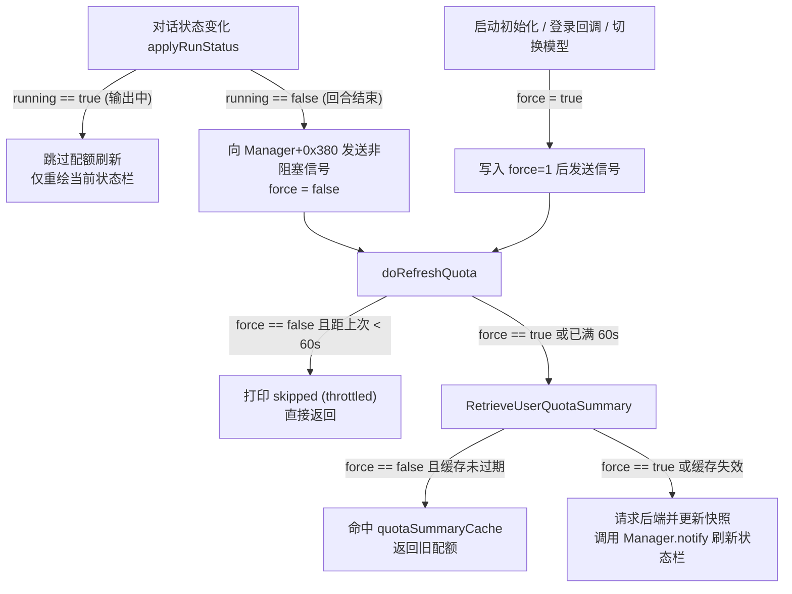

在日常使用 Antigravity CLI（`agy`）时，我给终端状态栏配置了一个自定义脚本 `~/.gemini/antigravity-cli/statusline.sh`。正常情况下，状态栏会把当前工作目录、模型名称、上下文窗口占用率，以及 **5 小时 / 7 天** 两个配额桶的剩余比例与倒计时整整齐齐地铺满终端底部：

```text
? for shortcuts    📂 ~/tools | ● Orchestrator (Argon) | 📜 12.4% (24k/1000k) | ⏳ 2h 0m | 5H: 82% | ⏳ 2d 0h | 7D: 65%
```

但今天连续跑了好几轮复杂任务，我突然发现一个怪现象：**状态栏左侧的上下文窗口数字（`📜`）每轮都在老老实实上涨，可右侧的 `5H` 和 `7D` 配额百分比却纹丝不动，始终停留在 `100%`**。

起初我以为只是服务端缓存或者刷新延迟，但查了一整套日志、脚本和二进制汇编之后，才发现背后其实叠了 **3 层原因** —— 既有状态栏脚本里隐藏的模型分流 Bug，也顺带摸清了 `agy` 底层 Go 二进制对配额刷新的全部节流与缓存策略。

---

## 1. 第一层原因：模型名正则把内部模型踢进了 `3p` 配额桶

`agy` 在每次刷新状态栏时，会在 `~/.gemini/antigravity-cli/settings.json` 读取配置并拉起外部脚本：

```json
{
  "model": "Orchestrator (Argon)",
  "statusLine": {
    "type": "command",
    "command": "/Users/alex/.gemini/antigravity-cli/statusline.sh",
    "enabled": true
  }
}
```

运行期间，`agy` 会通过标准输入向 `statusline.sh` 喂入一行 JSON，核心结构包含当前目录 `.cwd`、模型信息 `.model.display_name`、上下文使用情况 `.context_window`，以及按配额池分组的 `.quota` 对象（例如 `gemini-5h`、`gemini-weekly`、`3p-5h`、`3p-weekly`）。

打开 `~/.gemini/antigravity-cli/statusline.sh` 查看第 11–20 行，问题一眼就暴露出来了：

```bash
# Determine the quota prefix based on the model name
if [[ "$model_name" =~ [Gg]emini ]]; then
  quota_prefix="gemini"
else
  quota_prefix="3p"
fi

# 计算 5H 和 7D 的剩余百分比并取整
quota_5h_pct=$(echo "$JSON_INPUT" | jq -r ".quota[\"${quota_prefix}-5h\"].remaining_fraction // 1 | . * 100 | round")
quota_weekly_pct=$(echo "$JSON_INPUT" | jq -r ".quota[\"${quota_prefix}-weekly\"].remaining_fraction // 1 | . * 100 | round")
```

逻辑原本的设想是：如果模型名字里带 `Gemini`，就去读 `gemini-5h` 和 `gemini-weekly`；否则就归为第三方模型（3P，如 Claude、GPT 等），去读 `3p-5h` 和 `3p-weekly`。

可问题是，我现在使用的模型显示名称是 **`Orchestrator (Argon)`**，压根不含 `"Gemini"` 这几个字母！

于是脚本执行时出现了极具戏剧性的“错位消费”：
1. `[[ "$model_name" =~ [Gg]emini ]]` 匹配失败，代码掉进 `else` 分支，`quota_prefix` 被设成 **`"3p"`**。
2. 对话过程实际上一直在消耗 `gemini-5h` 与 `gemini-weekly` 配额；
3. 但状态栏右侧却一直在盯着 `3p-5h` 与 `3p-weekly`（第三方模型配额池）看，自然怎么跑都是 `100%` 一动不动。

---

## 2. 继续深挖：`agy` 到底什么时候才会去后台刷新 `.quota`？

如果只是改掉脚本里的正则，事情到这里就结束了。但排查过程中我还产生了一个好奇：**就算配额桶匹配对了，`agy` 本身对 `.quota` 数据的更新频率到底有多快？为什么有时候连续聊好几轮也没见配额跳动？**

为了拿到确切答案，我先检查了 `~/.gemini/antigravity-cli/cli.log`，日志里已经透出不少端倪：

```text
I1118 15:10:17.096910      48 quota_manager.go:36] doRefreshQuota: skipped (not logged in)
...
I1118 15:10:23.234607      88 model_config_manager.go:375] Propagating selected model override to backend: label="Orchestrator (Argon)"
I1118 15:10:23.234762      48 quota_manager.go:45] doRefreshQuota: starting reload (force=true)
...
I1118 15:12:59.735077      48 quota_manager.go:45] doRefreshQuota: starting reload (force=false)
I1118 15:25:12.245543      48 quota_manager.go:45] doRefreshQuota: starting reload (force=false)
I1118 15:30:42.971295   11052 model_config_manager.go:375] Propagating selected model override to backend: label="Orchestrator (Argon)"
I1118 15:30:42.971477      48 quota_manager.go:45] doRefreshQuota: starting reload (force=true)
```

而在历史日志里，还能看到类似这样的记录：

```text
I1116 02:48:16.376937     229 quota_manager.go:41] doRefreshQuota: skipped (throttled)
```

同一个 `doRefreshQuota`，有时传 `force=false`，有时传 `force=true`，间隔太近还会打印 `skipped (throttled)`。要彻底看清状态机，只能直接看 `~/.local/bin/agy` 的机器码。

### 2.1 Stripped Go 二进制的符号恢复：解析 `__lrodata_gopcln`

用常规手段查看 `/Users/alex/.local/bin/agy` 会直接吃闭门羹——Mach-O 的标准符号表已经被剥离（stripped）：

```bash
nm /Users/alex/.local/bin/agy | grep doRefreshQuota        # 无输出
go tool objdump -s "doRefreshQuota" /Users/alex/.local/bin/agy  # 无输出
```

好在 Go 二进制为了支持运行时的 `runtime.Caller` 与 Panic 调用栈还原，即使 stripped 也会在可执行文件中保留一份完整的 **pclntab（PC-to-Line Table）**。用 `otool -l` 查看 Mach-O Section，很容易就能找到它：

```text
  sectname __text
   segname __TEXT
      addr 0x00000001000011c0
    offset 4544
  ...
  sectname __lrodata_gopcln
   segname __TEXT
      addr 0x00000001047c0f00
    offset 75239168
```

用 Python 读取 `offset = 75239168` 处的 pclntab 头部时，还踩了一个小坑：一开始按早期版本的 32 位字段格式 `<IBBBBQIIIIQQQ` 解包，结果 `textStart` 错位成 `0x0` 并报出 `struct.error`。这是因为在 **Go 1.18+** 64 位二进制中，`nfunc` 到 `pclnOffset` 这 8 个头部字段全部是 8 字节 `uintptr`，应该使用 `<IBBBBQQQQQQQQ`：

```python
import struct

with open("/Users/alex/.local/bin/agy", "rb") as f:
    f.seek(75239168)
    pcln = f.read(75000000)

(
    magic, pad1, pad2, minLC, ptrSize,
    nfunc, nfiles, textStart, funcnameOffset,
    cuOffset, filetabOffset, pctabOffset, pclnOffset
) = struct.unpack_from("<IBBBBQQQQQQQQ", pcln, 0)

textStart = 0x1000011c0
# 输出: magic=0xfffffff1 nfunc=189648 textStart=0x1000011c0 pclnOffset=35521624
```

解析出全部 **189,648** 个函数符号后，核心逻辑的地址边界立刻水落石出：

| 函数符号 | 地址区间 | 职责简述 |
| --- | --- | --- |
| `store.(*Manager).applyRunStatus` | `0x102f15c50 .. 0x102f15e20` | 对话运行状态切换时触发后续动作 |
| `store.(*Manager).TriggerQuotaRefresh` | `0x102f3ab70 .. 0x102f3ac00` | 向后台 `quotaLoop` 发送刷新信号 |
| `store.(*Manager).doRefreshQuota` | `0x102f3ac00 .. 0x102f3b0e0` | 执行 60 秒节流并调用配额拉取接口 |
| `store.BuildStatusLineData` | `0x102f41c60 .. 0x102f42ee0` | 组装传给 `statusline.sh` 的 JSON 数据 |
| `store.(*Manager).triggerStatusLineUpdate` | `0x102f436a0 .. 0x102f438b0` | 触发外部状态栏脚本执行 |
| `store.(*StatusLineRunner).Run` | `0x102f43fd0 .. 0x102f44240` | 异步启动子进程运行状态栏命令 |
| `codeassistclient.(*CodeAssistClient).RetrieveUserQuotaSummary` | `0x101c40270 ..` | 带缓存地向后端请求用户配额摘要 |

### 2.2 汇编里的完整链路：懒刷新 + 60 秒节流 + 内存缓存

将上述地址区间的 arm64 指令反汇编并关联回函数名后，整条配额更新链路的真实行为就非常清晰了：



汇编中可以一一印证这三道关卡：

1. **对话进行中绝不拉取配额（`applyRunStatus` @ `0x102f15c50`）**  
   在状态变更逻辑处（`0x102f15d60: tbz w1, #0x0, 0x102f15d78`），只有当 `running` 为 `0`（整轮对话结束回到空闲状态）时，执行流才会继续走到 `0x102f15d9c`，从 `[x0, #0x380]` 取出 `quotaLoop` 控制结构并调用 `runtime.selectnbsend` 触发刷新；而当 `running` 为 `1`（正在流式输出或执行工具调用）时，函数在调用状态栏刷新之后直接通过分支 `b 0x102f15de8` 跳去 `notify()`，完全不碰 `quotaLoop`。而且此处 `applyRunStatus` 并没有向 `[x2, #0x18]` 写入 `force=1` 标记。

2. **客户端 60 秒硬节流（`doRefreshQuota` @ `0x102f3ac00`）**  
   在 `0x102f3ad38` 先判断 `tbnz w3, #0x0, 0x102f3ad60`——只要不是 `force=true`，就会立刻调用 `time.Since`（`0x102f3ad48`），随后用三条指令拼出一个极其醒目的 64 位纳秒常量：

   ```asm
   102f3ad4c: d28b0003    mov   x3, #0x5800
   102f3ad50: f2bf08e3    movk  x3, #0xf847, lsl #16
   102f3ad54: f2c001a3    movk  x3, #0xd, lsl #32       ; x3 = 0xdf8475800 = 60,000,000,000 ns (60s)
   102f3ad58: eb03001f    cmp   x0, x3
   102f3ad5c: 5400168b    b.lt  0x102f3b02c             ; 不足 60 秒则跳往 "doRefreshQuota: skipped (throttled)"
   ```

   也就是说，如果你连续发出多条短对话，只要两次回合结束的间隔小于 **60 秒**，客户端本地就会直接节流跳过。

3. **SDK 侧的内存缓存（`RetrieveUserQuotaSummary` @ `0x101c40270`）**  
   即便是过了 60 秒节流，`applyRunStatus` 触发时传的依然是 `force=false`。在 `0x101c4028c` 可以看到：只有当 `force` 参数非零时，才会先执行 `0x101c50db0` 清理 `[x0, #0x68]` 挂载的 `quotaSummaryCache` 缓存；如果 `force == false`，则直接调用缓存读取路径 `0x101c50ea0`。只有在应用启动、鉴权回调，或手动通过 `/model` 切换模型（`cli.log` 中会紧随 `model_config_manager.go:375` 记录一次 `force=true`）时，才会强制击穿缓存立即拉取最新值。

---

## 3. 第三层因素：整数四舍五入抹平了微小消耗

回到 `~/.gemini/antigravity-cli/statusline.sh` 第 19–20 行，还有个容易让人误以为“没更新”的小细节：

```bash
quota_5h_pct=$(echo "$JSON_INPUT" | jq -r ".quota[\"${quota_prefix}-5h\"].remaining_fraction // 1 | . * 100 | round")
quota_weekly_pct=$(echo "$JSON_INPUT" | jq -r ".quota[\"${quota_prefix}-weekly\"].remaining_fraction // 1 | . * 100 | round")
```

左侧上下文窗口计算用到了 `. * 10 | round / 10` 来保留一位小数，而右侧配额却直接使用了 `round` 四舍五入为整数。对于总额度较大或按周统计的 **`7D`** 配额来说，单轮对话消耗如果不足 `0.5%`，哪怕数据实际上已经递减了，屏幕上的整数百分比依然会因为四舍五入显得毫无变化。

---

## 4. 修复与验证

搞清楚全部因果后，主因已经锁定在第一步的模型分流逻辑上。随着模型家族不断扩展，各种内部命名、Router / Orchestrator 模型名层出不穷，再用“包含 `Gemini` 才走 `gemini` 桶”的白名单写法注定会反复踩坑。

更稳妥的做法是把判断反转过来：**显式匹配第三方模型标识进入 `3p`，其余所有模型默认归入 `gemini` 配额桶**。

修改 `~/.gemini/antigravity-cli/statusline.sh` 第 11–16 行：

```bash
# Determine the quota prefix based on the model name
if [[ "$model_name" =~ [Cc]laude|[Ss]onnet|[Oo]pus|[Hh]aiku|[Gg][Pp][Tt]|3[Pp] ]]; then
  quota_prefix="3p"
else
  quota_prefix="gemini"
fi
```

构造两份带有显著区分度配额数值的模拟 JSON（设定 `gemini-*` 为 `82% / 65%`，`3p-*` 为 `11% / 22%`）直接通过管道喂给脚本做回归测试：

```bash
# Test 1: Orchestrator (Argon)
echo '{"cwd":"/Users/alex/tools","model":{"display_name":"Orchestrator (Argon)"},"terminal_width":140,"agent_state":"idle","quota":{"gemini-5h":{"remaining_fraction":0.82,"reset_in_seconds":7200},"gemini-weekly":{"remaining_fraction":0.65,"reset_in_seconds":172800},"3p-5h":{"remaining_fraction":0.11,"reset_in_seconds":3600},"3p-weekly":{"remaining_fraction":0.22,"reset_in_seconds":86400}}}' | /Users/alex/.gemini/antigravity-cli/statusline.sh | sed -E $'s/\x1b\\[[0-9;]*m//g'

# Test 2: Claude 3.7 Sonnet
echo '{"cwd":"/Users/alex/tools","model":{"display_name":"Claude 3.7 Sonnet"},"terminal_width":140,"agent_state":"idle","quota":{"gemini-5h":{"remaining_fraction":0.82,"reset_in_seconds":7200},"gemini-weekly":{"remaining_fraction":0.65,"reset_in_seconds":172800},"3p-5h":{"remaining_fraction":0.11,"reset_in_seconds":3600},"3p-weekly":{"remaining_fraction":0.22,"reset_in_seconds":86400}}}' | /Users/alex/.gemini/antigravity-cli/statusline.sh | sed -E $'s/\x1b\\[[0-9;]*m//g'
```

实测输出：

```text
=== Test 1: Orchestrator (Argon) ===
? for shortcuts                                📂 ~/tools | ● Orchestrator (Argon) | 📜 0% (0k/0k) | ⏳ 2h 0m | 5H: 82% | ⏳ 2d 0h | 7D: 65%

=== Test 2: Claude 3.7 Sonnet ===
? for shortcuts                                   📂 ~/tools | ● Claude 3.7 Sonnet | 📜 0% (0k/0k) | ⏳ 1h 0m | 5H: 11% | ⏳ 1d 0h | 7D: 22%
```

`Orchestrator (Argon)` 已经能够正确命中 `gemini-5h` 和 `gemini-weekly`，第三方模型 `Claude 3.7 Sonnet` 也准确保留在 `3p-*` 分支上。

---

## 小结

回过头看，这次看似“数据卡死”的问题，其实是由 **脚本正则假设过窄** 与 **客户端节流/缓存机制** 共同造成的可观测性错觉：

1. 在编写状态栏等外围工具时，如果业务端在不断推出新代号（例如 `Orchestrator (Argon)`），用黑名单过滤明确的第三方模型，往往比白名单穷举第一方模型更抗变化。
2. 当遇到 stripped 的 Go 二进制工具行为不符合直觉时，通过 `otool -l` 找到 `__lrodata_gopcln` 并按 Go 1.18+ 的 `<IBBBBQQQQQQQQ` 结构恢复符号表，只需要十几行 Python 就能配合 `objdump` 定位出精确的状态机条件。
3. 至于日常使用的小技巧：因为 `agy` 仅在启动或切换模型时触发 `force=true` 刷新配额，如果某次实在急着确认精确余量，手动切一下模型（哪怕切到同模型配置再切回）就能立刻跳过 **60 秒** 节流与内存缓存拿到最新值。
