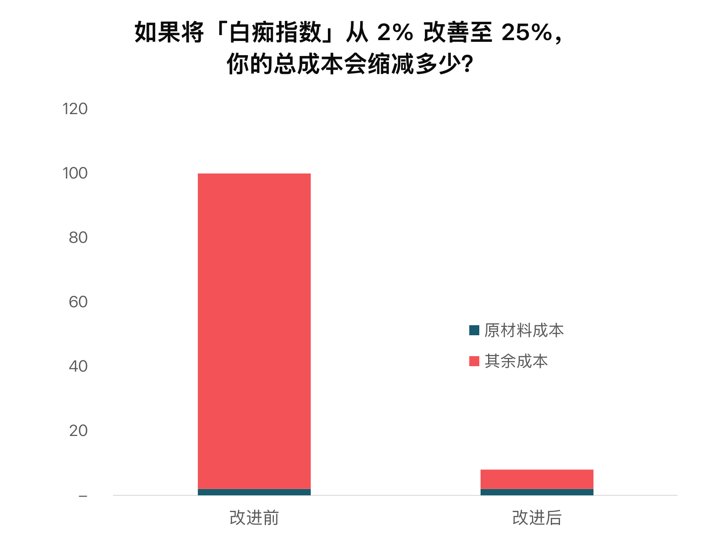
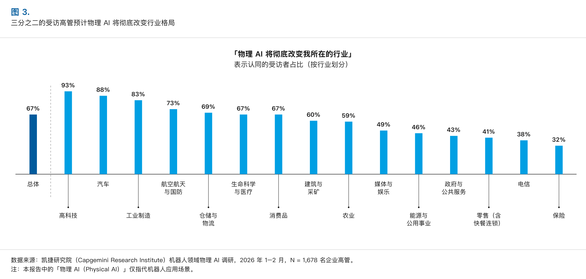

创办超音速客机公司 Boom 十二年之后，软件工程师出身的 CEO Blake Scholl 总结过一条反直觉的经验。传统航空与硬科技团队里，绝大多数硬件工程其实是写在电子表格里的一次性计算，比如输入机翼结构载荷算出翼梁尺寸，或者输入热载荷算出空调系统规模。Boom 要求工程师直接去写「用来设计硬件的软件系统」，保证任何部件明天换一套假设就能自动重新生成。靠着自研的涡轮机械设计工具，以前 **100 名** 工程师要干半年的设计活，如今 **1 名** 工程师就能实时跑完，整架飞机更有 **65%** 的机身结构由另一套工具自动生成。这家公司最终靠 **50 人** 造出了无音爆超音速飞机，靠 **150 人** 造出了全尺寸超音速涡轮发动机。[Blake Scholl 原帖](https://x.com/bscholl/status/2118524700796305669)

2026 年 11 月 18 日，Tomas Pueyo 在长文《Hardware Is Software》里接过这个案例，一路往产业下游推演。既然硬件工程正在变成软件，大模型又能接管软件编写，再叠加上人形机器人替代车间蓝领，整条制造业价值链的总成本最高可以砍掉 **74%**。不少人觉得实体制造业能躲开 AI 冲击，Pueyo 的推演直接冲着这个普遍印象去。顺着他的案例和算式逐项复核就会发现，研发端「硬件软件化」已经在特定品类里跑通，但 **74%** 这个惊人降幅建立在「只扣减人工工资、暂不计入算力与机器人资本折旧」的毛口径之上，不同硬件行业被改写的速度也会在物理测试和灵巧操作两道门槛前大幅分化。[Hardware Is Software 原文](https://unchartedterritories.tomaspueyo.com/p/hardware-is-software)

## 硬件设计先一步变成可重跑的代码

在白领研发端，用算法和模型替代手工工程计算，确实已经在结构件与标准电子硬件上拿到了硬数据。NASA 戈达德航天中心在 2022 年发表过一项航天仪器结构实验，工程师只负责定义载荷边界与接口要求，交由生成式设计算法与数字制造设备产出零件，最终零件比人类专家方案成本低 **40%**、重量轻 **66%**，设计耗时缩短了 **85%**。到了 2026 年 11 月，Terraform 创始人 Casey Handmer 展示了一个更极端的个人项目。他让 Claude 设计一块用微波雷达监测心率与呼吸频率的印制电路板（PCB），模型包揽了电路原理图、物理布线和固件及配套软件，他只需把文件发给自动化打样贴片厂，花几百美元就拿到了能测距、测角甚至识别打字动作的成品板。[NASA 2022 生成式设计论文](https://ntrs.nasa.gov/citations/20220012523)

这两个案例之所以顺畅，有一个共同前提。航天仪器支架遵循清晰的力学方程，双层或四层雷达电路板背后则有高度标准化的 EDA 文件格式与成熟的贴片代工产线。一旦跨出这个边界，推演的跳跃感就会立刻显现。Handmer 在另一条动态里宣称，如今的前沿模型花不到 **100 万美元** 的 Token 成本，就能把英伟达的 GPU 硬件设计和 CUDA 软件栈从头重构出来。英伟达确实把晶圆制造交给了台积电，Google 也早就利用 AlphaChip 辅助设计自研 TPU，但现代旗舰 GPU 与 CUDA 真正的壁垒在于跨代际软件生态兼容、底层算子调优以及流片前后的硅片勘误验证，这些长尾工程验证很难单靠百万美元级别的推理生成直接跨过去。[DeepMind AlphaChip 介绍](https://deepmind.google/blog/how-alphachip-transformed-computer-chip-design/)

## 重算供应链上那笔 74% 的降本账

Pueyo 把研发端与制造端的降本潜力推向极致时，借用了马斯克提出的「白痴指数」（Idiot Index）。马斯克早年去俄罗斯询价购买弹道导弹时，在返程飞机上拉表测算，发现火箭的原材料成本只占总售价的 **2%**。传统定义里，白痴指数等于成品总价除以原材料成本（即 **50 倍**），Pueyo 在图表里则反过来用「原材料占总成本的比重」来衡量效率。假设原材料绝对成本固定为 **2 个单位**，它在总成本中的占比从 **2%** 提高到 **25%**，就意味着成品总成本从 **100** 压缩到了 **8**（`2 / 0.25 = 8`），原材料之外的其余成本从 **98** 骤降到 **6**，总降幅高达 **92%**。猎鹰重型把发射成本砍掉 **98%**，星舰计划在此基础上再降 **93%**，靠的就是在原本冗余极高的航天工业里挤压这层水分。[Wired 马斯克访谈](https://www.wired.com/2012/10/ff-elon-musk-qa/)

传统航天业存在大量行政低效与加成合同，未必能代表充分竞争的一般制造业。为此，Pueyo 给出了一家典型制造企业 A 的成本构成，试图算出普通工业品在全价值链上的降本幅度。

| 成本项目 | 占企业预算比重 | AI 与自动化作用方式 |
| --- | --- | --- |
| 蓝领、白领与外包人力 | 约 **26%** | 用大模型替代研发管理（研发约占制造业营收 **5% 至 20%**），用机器人替代车间操作 |
| 外购零部件、包装与原材料 | 约 **62%** | 上游供应商同步削减人力，并通过更优设计减少材料损耗 |
| 机器设备 | 约 **3%** | 设备设计成本下降，但自动化改造会增加新设备投入 |
| 能源、维护与土地厂房 | 约 **4.7%** | 能源约 **1.8%**，维护与废料处理约 **1.5%**，土地与厂房约 **1.4%** |

顺着这张表核对 Pueyo 的算术，能看清 **74%** 是怎么推出来的。企业 A 自身人力占 **26%**，向供应商采购的零部件等投入占 **62%**，设备与能源、厂房及未列明杂项合占约 **12%**。Pueyo 先算第一轮：上游供应商削减人力并优化用料后，企业 A 那 **62%** 的采购支出下降 **12 个百分点**，叠加上企业 A 自己砍掉约 **25%** 的人力成本，企业 A 的总成本先降 **37%**，并在市场竞争中转化为 **37%** 的降价。接着他又算第二轮：企业 A 反过来压迫供应商 B 也降价 **37%**，供应商 B 再压迫更上游同步降价 **37%**，一路传导后得出总成本下降 **74%**。

把这段文字换算成投入产出的无穷级数，逻辑会严格得多。如果供应链每一级都把 **62%** 的支出付给上一级，只保留 **38%** 作为本级内部成本与增加值，其中本级人力占总支出的 **26%**，那么把整条上游供应链里每一层的人力全部累加起来，人力在终端产品总成本里的真实总占比就是 `26% / (1 - 0.62) = 68.4%`。再算上每一层通过优化设计省下的 **2 个百分点** 材料损耗（`2% / 0.38 ≈ 5.3%`），全链条理论上能挤掉的成本上限刚好落在 **73.7%**，与 Pueyo 笔下的 **74%** 吻合。[NSF 制造业研发统计](https://www.ncses.nsf.gov/pubs/nsf25353)

问题出在这笔账只算了减法，没有同步计入加法。Pueyo 在后文承认，被砍掉的工资支出不会凭空消失，企业必须转向资本开支，一边付费购买模型推理（inference）算力来顶替白领，一边采购专用机器与人形机器人来顶替蓝领。如果每一级工厂为了省掉 **100 美元** 工资，需要新花 **35 到 50 美元** 去付算力账单与机器人折旧，外加电力和新增维保，那么传导到终端产品的净成本降幅就会从 **74%** 收窄到 **35% 至 45%** 之间。即便如此，接近四成的全行业净成本下移依然足以重塑制造业格局，并让终端价格结构里的矿产资源与电力权重显著上升。

## 原子世界的两道闸门决定了时间表

这套成本重估会在几年内兑现，取决于物理世界的自动化速度。凯捷研究院在 2026 年 1 月至 2 月调研了全球 **1,678 名** 企业高管，**67%** 的受访者认为机器人领域的物理 AI（Physical AI）将彻底改变所在行业，其中高科技行业认同率达 **93%**，汽车业达 **88%**，工业制造业达 **83%**。硬件演示也在快速刷新纪录，例如 Figure 公司的 F.03 人形机器人在 2026 年 5 月完成了连续 **200 小时** 零故障直播，自主分拣了 **249,560 件** 包裹。[凯捷 2026 物理 AI 报告](https://www.capgemini.com/wp-content/uploads/2026/05/CRI_Physical-AI-Report-Final-web-version-2.pdf)

围绕这场变革的落地速度，Pueyo 在文末摆出了针锋相对的两派时间表。激进派认为 **1 到 4 年** 就够了，假如传统制造大厂困于组织惯性与既得利益，模型实验室或私募股权机构（PE）完全可以直接收购管理低效的工厂，裁撤冗余人力并换上智能体与自动化测试产线。渐进派则认为剧变需要 **5 到 20 年**，甚至十到二十年才能铺开。

把前文的工程细节放回这场争论里，单一时间表其实遮住了不同硬件品类之间的巨大裂谷。在传送带旁分拣标准包裹属于受控环境下的抓取循环，而在狭小机舱里穿引柔性线束、装配精密公差配合件，依然受制于机械手灵巧度与触觉反馈，人形机器人自身的规模化量产爬坡也需要以年为单位的产线建设。另一道绕不开的闸门是实物的安全鉴定与物理寿命测试。哪怕 Boom 用软件把半年的气动与涡轮设计压缩到了实时生成，发动机叶片的高温疲劳试验、整机风洞测试与适航取证仍然必须按真实物理时间跑完，算力变便宜并不能让金属疲劳试验跳过小时数。

由此来看，「硬件即软件」最先在 **1 到 4 年** 内打穿的，会是设计权重高、制造端早已高度标准化和数控化的品类，例如消费电子电路板、CNC 与增材制造结构件以及中小型机电设备。航空器、重型装备与上游采矿业则会留在更长的周期里，一边缓慢消化新工具带来的研发提效，一边让手里掌握的矿山品位、廉价电力与物理验证设施变得比以往更值钱。
